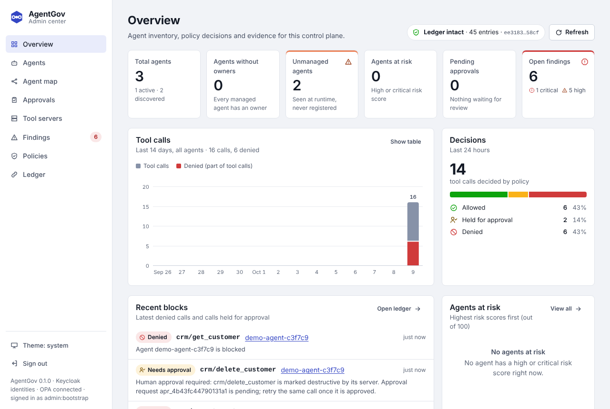
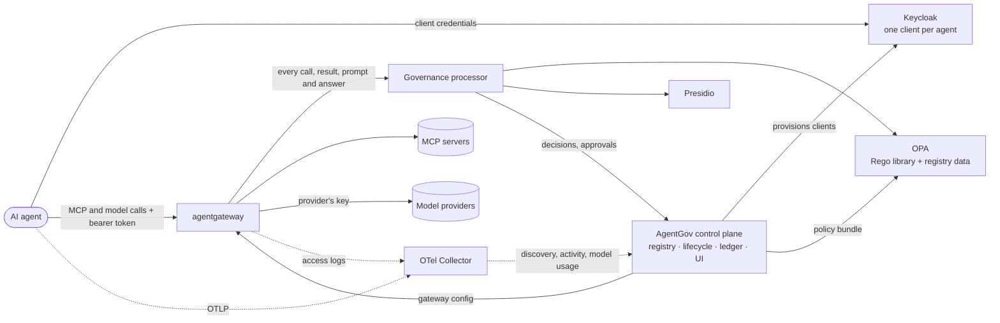

# AgentGov

[](LICENSE)

**Open-source governance for AI agents.** AgentGov gives every agent you run an entry in
a registry, its own identity, access policy on every tool call and model call, data
protection, token budgets, human approval for risky actions, a kill switch and an audit
trail. It works with any agent
framework or cloud, and it is built from open-source projects that security teams already
trust: Keycloak, Open Policy Agent, agentgateway, Presidio and OpenTelemetry.

AgentGov uses [Microsoft Agent 365](https://learn.microsoft.com/en-us/microsoft-agent-365/overview)
as its functional baseline. The [parity matrix](docs/baseline-agent365.md) shows each
Agent 365 capability next to its AgentGov equivalent. You don't need Agent 365 to run
AgentGov ([why](#do-i-need-agent-365)).

> **Status: alpha.** The reference deployment runs end to end; `scripts/ci.sh --e2e` exercises it.
> APIs and manifests may change before 1.0.



## Why

Agents act with their own credentials. They read customer records, call internal APIs
and change things, and nobody reviews each step. Governing them needs what we already
built for people and services: an inventory, identities, access policy, data protection
and audit. It also needs controls that are new: per-tool permissions, human approval for
consequential actions, defences against prompt injection and poisoned tools, and a way
to stop an agent everywhere at once.

Agent 365 provides this for Microsoft 365 tenants. AgentGov provides it for everything
else, without new proprietary components on the enforcement path. Identity, policy
decisions, MCP enforcement, PII detection and telemetry are all handled by established
projects. The code in this repository is the part none of them provides: the agent
registry and its lifecycle, the reconcilers that keep those projects in sync with it, a
policy processor for the gateway, and a tamper-evident evidence ledger.

## Do I need Agent 365?

No. AgentGov runs on its own open-source stack and needs no Microsoft account or
licence. Agent 365 is the yardstick it is measured against, because it is the most
complete published description of what governing agents involves.

Whether AgentGov replaces Agent 365 depends on where your agents run:

| Your agents | What AgentGov does |
|---|---|
| Built and run by you, with any framework or cloud, calling tools over MCP | The whole job: registry, an identity per agent, policy on every tool call and model call, data protection, approvals, a kill switch and an audit trail. For these agents it is an alternative to Agent 365, and the option for organisations that don't use Microsoft 365 |
| Built in Microsoft 365 Copilot, Copilot Studio or Agent Builder | Works alongside Microsoft's admin centers. These agents don't pass through AgentGov's gateway, so Microsoft carries out the decisions about them. AgentGov lists them, checks their connectors and instructions, and keeps them in the same registry and audit trail as your other agents. With the Microsoft services you have, it also reads their Entra identities, who uses them and Defender's alerts about them; has Power Platform enforce its connector allowlist; decides Copilot Studio agents' tool calls with its own policies; and quarantines or blocks agents as the admin who signed in ([connections](docs/microsoft-connections.md)) |

Each Microsoft connection is optional: AgentGov uses the ones it can reach and works
without the others. Agent 365 matters in three of them, because Microsoft offers them
only to tenants with an Agent 365 licence: syncing the Microsoft 365 agent catalog,
blocking Microsoft 365 agents from AgentGov, and Defender's threat detections for agents.
Without one, leave them off. Everything else works, including Copilot Studio agents:
importing or syncing them needs only a Microsoft Entra role that can read the Power
Platform inventory, such as Power Platform administrator or AI reader, and quarantining
them needs the AI administrator or Power Platform administrator role
([details](docs/platforms.md)).

## Capabilities

| Agent 365 pillar | What AgentGov does | Built on |
|---|---|---|
| **Registry** | Inventory with owners and sponsors; IT-approved blueprints; lifecycle (request → approve → block → delete → restore); sponsor attestation; risk scores; posture findings; shadow-agent discovery; Microsoft 365, Copilot Studio and Entra Agent ID agents with a connector allowlist; approved MCP servers as an MCP registry for GitHub Copilot and VS Code, and the MCP servers developers set up on their machines | AgentGov control plane |
| **Access control** | A separate OAuth client per agent with 5-minute tokens; policy on every tool call and model call using live registry context; the models each blueprint allows, with daily token budgets; risk-based blocking; a kill switch that applies within a second; single sign-on and roles for the people who govern agents | Keycloak, OPA |
| **Visualization** | Overview dashboard, agent map (people → agents → tools), activity, findings, model usage and cost per agent; trace exploration | Admin UI, OpenTelemetry, Langfuse (optional) |
| **Interoperability** | A governed MCP gateway (MCP 2026-07-28); per-agent tool lists; any MCP client or framework; a model gateway for OpenAI, Anthropic, Gemini and OpenAI-compatible models, whose API keys agents never hold; in-process enforcement through the same policies | agentgateway, Agent Governance Toolkit (optional) |
| **Security** | PII redaction in tool results and prompts, secret blocking, prompt-injection, jailbreak and tool-poisoning defences, definition-drift detection, human approval for destructive tools, checks on agents' instructions for harmful or malicious content, hash-chained evidence ledger | Presidio, OPA, AgentGov processor, Granite Guardian (optional) |

Use only the parts you need. Each [feature](docs/features.md) can be turned off, and each
control at the gateway can run in monitor mode first: it records what it would have
stopped, without stopping anything, until you enforce it.

## How it works



1. When an agent is approved, the control plane creates its Keycloak client. The agent
   requests short-lived tokens with the client-credentials grant.
2. Every MCP request goes through agentgateway, which validates the token and passes the
   call to the governance processor (agentgateway's `ExtMcp` hook, fail-closed).
3. The processor scans arguments and results (Presidio for personal data; detectors for
   secrets, prompt injection and poisoned tool descriptions) and asks OPA for a
   decision. OPA evaluates the Rego library and your own policies against live registry
   data. The decision is to allow, deny, redact, or hold the call for human approval.
   Model calls take the same path: the processor checks each prompt and answer, and the
   gateway calls the provider with the provider's API key, which no agent holds.
4. The control plane keeps Keycloak, OPA and agentgateway in sync with the registry. A
   change such as blocking an agent reaches OPA through bundle long polling in well
   under a second. Every decision is appended to a hash-chained ledger.
5. Agents and the gateway send OpenTelemetry traces (GenAI semantic conventions). The
   control plane uses them to record activity and to discover agents that were never
   registered. The gateway's access logs give each model call's tokens, which the
   control plane counts against the agent's daily budget.
6. People sign in to the admin UI with single sign-on through the same Keycloak, and
   their roles decide whether they administer agents, approve requests or only audit.

[Architecture](docs/architecture.md) covers the design in detail: sequence diagrams,
trust boundaries, failure modes and scaling.

## Quickstart

You need Docker with Compose v2, Python 3.11 or later, and about 4 GB of free memory.

```bash
git clone https://github.com/sreent/ai-agent-governance-platform.git
cd ai-agent-governance-platform
docker compose -f deploy/compose/docker-compose.yml up -d --build --wait

python -m venv .venv && . .venv/bin/activate
pip install -e ".[demo]"
export AGENTGOV_TOKEN=dev-admin-token
agentgov apply -f examples/manifests      # blueprints, the CRM tool server, a model, an agent, a policy
python examples/agents/demo_agent.py
```

The demo registers a new agent and drives a real MCP client and model calls through
the gateway. It shows each control in turn:

1. **Registration**: the agent is requested, approved and given its own identity.
2. **Least privilege**: the agent only sees the tools its blueprint grants.
3. **Data loss prevention**: personal data in tool results is masked.
4. **Credentials never leave**: a secret in tool arguments is blocked.
5. **Indirect prompt injection**: a poisoned tool result is withheld.
6. **Ungranted tools** are refused even when called directly.
7. **Monitor mode**: with least privilege monitored, the same call goes through and the
   ledger records what would have stopped it; enforced again, it is refused.
8. **Human in the loop**: a destructive tool waits for an approver; once approved, the
   agent's retry goes through.
9. **Model calls**: the agent calls a model through the gateway with its own token,
   never the provider's key. Personal data in the prompt is masked, an ungranted model
   is refused, credentials are kept out of prompts and answers, and once the agent's
   metered tokens reach its daily budget, its calls are refused. A jailbreak attempt
   goes through but is recorded: jailbreak detection starts in monitor mode.
10. **Kill switch**: blocking the agent takes effect everywhere within a second.
11. **Shadow AI**: telemetry from an unregistered agent is discovered.
12. **Developer tools**: the MCP servers approved for developers are served as an MCP
    registry for GitHub Copilot, and a developer's laptop
    ([examples/developer-machine](examples/developer-machine)) reports its MCP servers:
    those that aren't approved, or skip the gateway, raise findings.
13. **Evidence**: every decision is in a ledger whose hash chain verifies.

Then look around:

* Admin UI: <http://localhost:8000/ui>. Choose *Sign in with single sign-on* and use
  `admin` (administrator), `alice` (approver, and the demo agent's sponsor) or `audrey`
  (auditor), all with the password `dev-password`; or paste the API token
  `dev-admin-token`
* API reference: <http://localhost:8000/docs>
* CLI: `agentgov agents list`, `agentgov findings`, `agentgov approvals list`,
  `agentgov ledger verify`. The CLI can do everything the UI can
  ([Administration](docs/administration.md) maps one to the other)
* Keycloak: <http://localhost:8180> (`admin` / `admin`), realm `agentgov`, which has one
  client per agent

On Kubernetes, the [Helm chart](deploy/helm/agentgov/README.md) installs the same stack.
For trace exploration, add Langfuse with
`-f deploy/compose/docker-compose.langfuse.yml` (see the
[deployment guide](deploy/compose/README.md)).

## Governance as code

Blueprints, tool servers, model providers, agents and policies are declarative manifests, applied with
`agentgov apply -f <dir>`, the UI's **Import manifests** or the API. They can also be
created and edited one at a time in the admin UI or with the CLI, and **Export manifests**
(`agentgov export`) writes everything back out as YAML:

```yaml
apiVersion: agentgov/v1alpha1
kind: Blueprint
metadata:
  name: customer-support
spec:
  risk_tier: medium
  require_sponsor: true
  attestation_days: 90
  permissions:
    - server: crm
      tools: [search_customers, get_customer, add_note, delete_customer]
---
apiVersion: agentgov/v1alpha1
kind: Agent
metadata:
  name: support-bot
spec:
  blueprint: customer-support
  owner: cx-platform
  sponsors: [alice@example.com]
  environment: prod
```

Organisation policies are plain Rego. They can deny a call, require approval for it, or
redact data from it. They are compiled and smoke-tested before OPA receives them:

```rego
package agentgov.custom.prod_verified_only

import data.agentgov.context as ctx

deny contains msg if {
	input.phase == "request"
	ctx.agent.environment == "prod"
	ctx.server.trust_level != "verified"
	msg := sprintf("Production agents may only use verified tool servers (%s is %s)", [ctx.server.name, ctx.server.trust_level])
}
```

See [Policies](docs/policies.md) for the decision model, the input document, testing and
what-if evaluation.

## Connecting your agents

* **MCP clients**: get the agent's credentials once
  (`agentgov agents credentials <agent>`), request tokens from Keycloak with the
  client-credentials grant, and connect to `http://<gateway>/mcp/<server>` with
  `Authorization: Bearer <token>`. Any MCP client works.
* **Models**: point any OpenAI client at `http://<gateway>/llm/<provider>/v1`, with the
  same token as its API key. The gateway adds the provider's key
  ([model calls](docs/models.md)).
* **Acting for a person**: exchange the person's token, from the app they use agents in,
  for a token of the agent's own (Keycloak's token exchange, RFC 8693), and call with that.
  Policy, the ledger and approvals then know whom the agent acts for
  ([acting for people](docs/acting-for-people.md)).
* **Developers' coding assistants**: GitHub Copilot reads the approved MCP servers from
  the MCP registry at `http://<control plane>/registry`, and `agentgov mcp scan --report`
  reports the ones developers set up ([developer tools](docs/developer-tools.md)).
* **Telemetry**: point the agent's OpenTelemetry exporter at the collector
  (`:4317` gRPC, `:4318` HTTP). Spans that follow the GenAI semantic conventions
  (`invoke_agent`, `execute_tool`, `chat`) feed activity, discovery and detective
  controls. Agents instrumented for Agent 365 already emit them.
* **Tools that never leave the process**: the
  [Agent Governance Toolkit](https://github.com/microsoft/agent-governance-toolkit) can
  query the same OPA (`data.agentos.allow`), so in-process tool calls follow the same
  policies ([how](docs/policies.md#in-process-enforcement-with-the-agent-governance-toolkit)).

## Components

| Component | Version | License | Role |
|---|---|---|---|
| [Keycloak](https://www.keycloak.org) | 26.8.0 | Apache-2.0 | Agent identities and tokens |
| [Open Policy Agent](https://www.openpolicyagent.org) | 1.21.1 | Apache-2.0 | Policy decision point |
| [agentgateway](https://agentgateway.dev) | 1.6.0 | Apache-2.0 | MCP and model gateway, policy enforcement point |
| [Presidio](https://github.com/data-privacy-stack/presidio) analyzer | 2.2.364 | MIT | Personal-data detection |
| [OpenTelemetry Collector](https://opentelemetry.io/docs/collector/) (contrib) | 0.162.0 | Apache-2.0 | Trace and access log ingestion and routing |
| [PostgreSQL](https://www.postgresql.org) | 17 | PostgreSQL | Registry, Keycloak and Langfuse storage |
| [Langfuse](https://langfuse.com) (optional) | 4.56.0 | MIT (core) | Trace exploration |
| [Agent Governance Toolkit](https://github.com/microsoft/agent-governance-toolkit) (optional) | — | MIT | In-process enforcement in agent frameworks |
| [IBM Granite Guardian](https://huggingface.co/ibm-granite/granite-guardian-4.1-8b) (optional) | 4.1 8B | Apache-2.0 | Classifier for harmful or malicious agent instructions |
| [llama.cpp](https://github.com/ggml-org/llama.cpp) server (optional) | b11541 | MIT | Serves Granite Guardian on a CPU |
| AgentGov control plane and processor | this repository | Apache-2.0 | Registry, lifecycle, reconcilers, governance processor, ledger, UI, CLI |

[Landscape](docs/landscape.md) explains why each project was chosen over the
alternatives, and how AgentGov relates to standards such as MCP, A2A, the OpenTelemetry
GenAI conventions and the OWASP Top 10 for Agentic Applications.

## Documentation

* [Agent 365 baseline and parity matrix](docs/baseline-agent365.md)
* [Architecture](docs/architecture.md)
* [Administration](docs/administration.md): the same tasks in the admin UI, the CLI and the API
* [Features](docs/features.md): choose which parts of AgentGov you use, and how strictly
* [Model calls](docs/models.md): model providers, which agents may call which models,
  usage, cost and token budgets
* [Developer tools](docs/developer-tools.md): an MCP registry for GitHub Copilot and VS
  Code, and the MCP servers developers set up on their machines
* [Acting for people](docs/acting-for-people.md): agents that act for a person, whom each
  may act for, the person in policy and the ledger, and approvals sent to the person
* [Agents on Microsoft 365 and Copilot Studio](docs/platforms.md): the agent catalog, the
  Copilot Studio inventory, the connector allowlist, and quarantining or blocking agents
  as the signed-in admin
* [Connecting AgentGov to Microsoft's services](docs/microsoft-connections.md): Entra
  Agent ID, the Purview audit log, Defender alerts, Power Platform connector policies and
  Copilot Studio threat detection, each optional
* [Agent instructions](docs/instructions.md): checking agents' system prompts for harmful
  or malicious content
* [Policies](docs/policies.md)
* [Landscape and standards](docs/landscape.md)
* [Architecture decision records](docs/adr)
* [Roadmap](docs/roadmap.md)
* [Reference deployment](deploy/compose/README.md) (Docker Compose) and the
  [Helm chart](deploy/helm/agentgov/README.md) for Kubernetes

## Repository layout

```text
src/agentgov/
  registry/     agents, blueprints, tool servers, model providers and usage, approvals,
                findings, risk, discovery, features
  policies/     Rego library (agentgov.*, agentos) and its tests
  opa/          bundle server and Rego validation
  identity/     Keycloak reconciler
  gateway.py    agentgateway config generator
  processor/    governance processor (ExtMcp, and the guardrail webhook for model calls)
                and detectors
  migrations/   database schema migrations (Alembic)
  api/  ui/     HTTP API and admin UI
  cli.py        the agentgov command
  mcp_scan.py   the MCP servers set up on a developer's machine (agentgov mcp scan)
deploy/compose/ reference deployment
deploy/helm/    Helm chart
examples/       manifests, a demo MCP server, a demo model, a developer's machine and the
                demo agent
docs/           design documents and ADRs
tests/          unit and integration tests
```

## Development

```bash
scripts/ci.sh          # lint, Rego checks, tests, image build; sets up .venv and opa
scripts/ci.sh --e2e    # plus the full stack and the demo walkthrough
```

See [CONTRIBUTING.md](CONTRIBUTING.md) for the full checklist, and
[SECURITY.md](SECURITY.md) to report a vulnerability.

## License

[Apache License 2.0](LICENSE). AgentGov is an independent project and is not affiliated
with or endorsed by Microsoft. Agent 365 is referenced only as a description of
capabilities.
