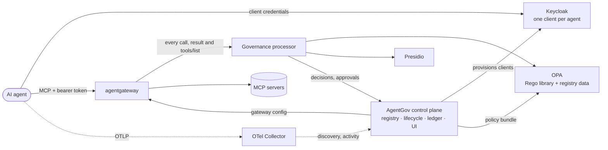

# AgentGov

[](LICENSE)

**Open-source governance for AI agents.** AgentGov gives every agent you run an entry in
a registry, its own identity, access policy on every tool call, data protection, human
approval for risky actions, a kill switch and an audit trail. It works with any agent
framework or cloud, and it is built from open-source projects that security teams already
trust: Keycloak, Open Policy Agent, agentgateway, Presidio and OpenTelemetry.

AgentGov uses [Microsoft Agent 365](https://learn.microsoft.com/en-us/microsoft-agent-365/overview)
as its functional baseline. The [parity matrix](docs/baseline-agent365.md) shows each
Agent 365 capability next to its AgentGov equivalent.

> **Status: alpha.** The reference deployment runs end to end; `scripts/ci.sh --e2e` exercises it.
> APIs and manifests may change before 1.0.


## Why

Agents act with their own credentials. They read customer records, call internal APIs
and change things, and nobody reviews each step. Governing them needs what we already
built for people and services: an inventory, identities, access policy, data protection
and audit. It also needs controls that are new: per-tool permissions, human approval for
consequential actions, defences against prompt injection and poisoned tools, and a way
to stop an agent everywhere at once.

Agent 365 provides this for Microsoft 365 tenants. AgentGov provides it for everything
else, without new proprietary components on the enforcement path. Identity, policy
decisions, MCP enforcement, PII detection and telemetry are all handled by established
projects. The code in this repository is the part none of them provides: the agent
registry and its lifecycle, the reconcilers that keep those projects in sync with it, a
policy processor for the gateway, and a tamper-evident evidence ledger.

## Capabilities

| Agent 365 pillar | What AgentGov does | Built on |
|---|---|---|
| **Registry** | Inventory with owners and sponsors; IT-approved blueprints; lifecycle (request → approve → block → delete → restore); sponsor attestation; risk scores; posture findings; shadow-agent discovery | AgentGov control plane |
| **Access control** | A separate OAuth client per agent with 5-minute tokens; policy on every tool call using live registry context; risk-based blocking; a kill switch that applies within a second | Keycloak, OPA |
| **Visualization** | Overview dashboard, agent map (people → agents → tools), activity, findings; trace exploration | Admin UI, OpenTelemetry, Langfuse (optional) |
| **Interoperability** | A governed MCP gateway (MCP 2026-07-28); per-agent tool lists; any MCP client or framework; in-process enforcement through the same policies | agentgateway, Agent Governance Toolkit (optional) |
| **Security** | PII redaction, secret blocking, prompt-injection and tool-poisoning defences, definition-drift detection, human approval for destructive tools, hash-chained evidence ledger | Presidio, OPA, AgentGov processor |

## How it works



1. When an agent is approved, the control plane creates its Keycloak client. The agent
   requests short-lived tokens with the client-credentials grant.
2. Every MCP request goes through agentgateway, which validates the token and passes the
   call to the governance processor (agentgateway's `ExtMcp` hook, fail-closed).
3. The processor scans arguments and results (Presidio for personal data; detectors for
   secrets, prompt injection and poisoned tool descriptions) and asks OPA for a
   decision. OPA evaluates the Rego library and your own policies against live registry
   data. The decision is to allow, deny, redact, or hold the call for human approval.
4. The control plane keeps Keycloak, OPA and agentgateway in sync with the registry. A
   change such as blocking an agent reaches OPA through bundle long polling in well
   under a second. Every decision is appended to a hash-chained ledger.
5. Agents and the gateway send OpenTelemetry traces (GenAI semantic conventions). The
   control plane uses them to record activity and to discover agents that were never
   registered.

[Architecture](docs/architecture.md) covers the design in detail: sequence diagrams,
trust boundaries, failure modes and scaling.

## Quickstart

You need Docker with Compose v2, Python 3.11 or later, and about 4 GB of free memory.

```bash
git clone https://github.com/sreent/ai-agent-governance-platform.git
cd ai-agent-governance-platform
docker compose -f deploy/compose/docker-compose.yml up -d --build --wait

python -m venv .venv && . .venv/bin/activate
pip install -e ".[demo]"
export AGENTGOV_TOKEN=dev-admin-token
agentgov apply -f examples/manifests      # blueprints, the CRM tool server, an agent, a policy
python examples/agents/demo_agent.py
```

The demo registers a new agent and drives a real MCP client through the gateway. It
shows each control in turn:

1. **Registration**: the agent is requested, approved and given its own identity.
2. **Least privilege**: the agent only sees the tools its blueprint grants.
3. **Data loss prevention**: personal data in tool results is masked.
4. **Credentials never leave**: a secret in tool arguments is blocked.
5. **Indirect prompt injection**: a poisoned tool result is withheld.
6. **Ungranted tools** are refused even when called directly.
7. **Human in the loop**: a destructive tool waits for an approver; once approved, the
   agent's retry goes through.
8. **Kill switch**: blocking the agent takes effect everywhere within a second.
9. **Shadow AI**: telemetry from an unregistered agent is discovered.
10. **Evidence**: every decision is in a ledger whose hash chain verifies.

Then look around:

* Admin UI: <http://localhost:8000/ui> (sign in with `dev-admin-token`)
* API reference: <http://localhost:8000/docs>
* CLI: `agentgov agents list`, `agentgov findings`, `agentgov approvals list`,
  `agentgov ledger verify`
* Keycloak: <http://localhost:8180> (`admin` / `admin`), realm `agentgov`, which has one
  client per agent

For trace exploration, add Langfuse with
`-f deploy/compose/docker-compose.langfuse.yml` (see the
[deployment guide](deploy/compose/README.md)).

## Governance as code

Blueprints, tool servers, agents and policies are declarative manifests, applied with
`agentgov apply -f <dir>` or through the API:

```yaml
apiVersion: agentgov/v1alpha1
kind: Blueprint
metadata:
  name: customer-support
spec:
  risk_tier: medium
  require_sponsor: true
  attestation_days: 90
  permissions:
    - server: crm
      tools: [search_customers, get_customer, add_note, delete_customer]
---
apiVersion: agentgov/v1alpha1
kind: Agent
metadata:
  name: support-bot
spec:
  blueprint: customer-support
  owner: cx-platform
  sponsors: [alice@example.com]
  environment: prod
```

Organisation policies are plain Rego. They can deny a call, require approval for it, or
redact data from it. They are compiled and smoke-tested before OPA receives them:

```rego
package agentgov.custom.prod_verified_only

import data.agentgov.context as ctx

deny contains msg if {
	input.phase == "request"
	ctx.agent.environment == "prod"
	ctx.server.trust_level != "verified"
	msg := sprintf("Production agents may only use verified tool servers (%s is %s)", [ctx.server.name, ctx.server.trust_level])
}
```

See [Policies](docs/policies.md) for the decision model, the input document, testing and
what-if evaluation.

## Connecting your agents

* **MCP clients**: get the agent's credentials once
  (`agentgov agents credentials <agent>`), request tokens from Keycloak with the
  client-credentials grant, and connect to `http://<gateway>/mcp/<server>` with
  `Authorization: Bearer <token>`. Any MCP client works.
* **Telemetry**: point the agent's OpenTelemetry exporter at the collector
  (`:4317` gRPC, `:4318` HTTP). Spans that follow the GenAI semantic conventions
  (`invoke_agent`, `execute_tool`, `chat`) feed activity, discovery and detective
  controls. Agents instrumented for Agent 365 already emit them.
* **Tools that never leave the process**: the
  [Agent Governance Toolkit](https://github.com/microsoft/agent-governance-toolkit) can
  query the same OPA (`data.agentos.allow`), so in-process tool calls follow the same
  policies ([how](docs/policies.md#in-process-enforcement-with-the-agent-governance-toolkit)).

## Components

| Component | Version | License | Role |
|---|---|---|---|
| [Keycloak](https://www.keycloak.org) | 26.8.0 | Apache-2.0 | Agent identities and tokens |
| [Open Policy Agent](https://www.openpolicyagent.org) | 1.21.1 | Apache-2.0 | Policy decision point |
| [agentgateway](https://agentgateway.dev) | 1.6.0 | Apache-2.0 | MCP gateway, policy enforcement point |
| [Presidio](https://github.com/data-privacy-stack/presidio) analyzer | 2.2.364 | MIT | Personal-data detection |
| [OpenTelemetry Collector](https://opentelemetry.io/docs/collector/) (contrib) | 0.162.0 | Apache-2.0 | Trace ingestion and routing |
| [PostgreSQL](https://www.postgresql.org) | 17 | PostgreSQL | Registry, Keycloak and Langfuse storage |
| [Langfuse](https://langfuse.com) (optional) | 4.56.0 | MIT (core) | Trace exploration |
| [Agent Governance Toolkit](https://github.com/microsoft/agent-governance-toolkit) (optional) | — | MIT | In-process enforcement in agent frameworks |
| AgentGov control plane and processor | this repository | Apache-2.0 | Registry, lifecycle, reconcilers, governance processor, ledger, UI, CLI |

[Landscape](docs/landscape.md) explains why each project was chosen over the
alternatives, and how AgentGov relates to standards such as MCP, A2A, the OpenTelemetry
GenAI conventions and the OWASP Top 10 for Agentic Applications.

## Documentation

* [Agent 365 baseline and parity matrix](docs/baseline-agent365.md)
* [Architecture](docs/architecture.md)
* [Policies](docs/policies.md)
* [Landscape and standards](docs/landscape.md)
* [Architecture decision records](docs/adr)
* [Roadmap](docs/roadmap.md)
* [Reference deployment](deploy/compose/README.md)

## Repository layout

```text
src/agentgov/
  registry/     agents, blueprints, tool servers, approvals, findings, risk, discovery
  policies/     Rego library (agentgov.*, agentos) and its tests
  opa/          bundle server and Rego validation
  identity/     Keycloak reconciler
  gateway.py    agentgateway config generator
  processor/    ExtMcp governance processor and detectors
  api/  ui/     HTTP API and admin UI
  cli.py        the agentgov command
deploy/compose/ reference deployment
examples/       manifests, a demo MCP server and the demo agent
docs/           design documents and ADRs
tests/          unit and integration tests
```

## Development

```bash
scripts/ci.sh          # lint, Rego checks, tests, image build; sets up .venv and opa
scripts/ci.sh --e2e    # plus the full stack and the demo walkthrough
```

See [CONTRIBUTING.md](CONTRIBUTING.md) for the full checklist, and
[SECURITY.md](SECURITY.md) to report a vulnerability.

## License

[Apache License 2.0](LICENSE). AgentGov is an independent project and is not affiliated
with or endorsed by Microsoft. Agent 365 is referenced only as a description of
capabilities.
