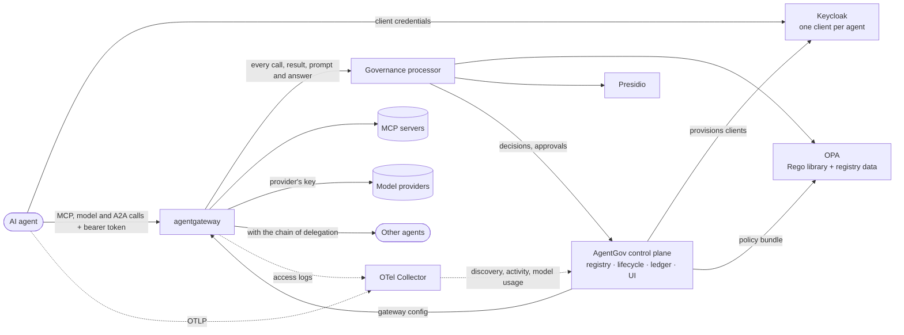

# AgentGov

[](LICENSE)

**Open-source governance for AI agents.** AgentGov gives every agent you run an entry in
a registry, its own identity, access policy on every tool call and model call, data
protection, token budgets, human approval for risky actions, a kill switch and an audit
trail. It works with any agent
framework or cloud, and it is built from open-source projects that security teams already
trust: Keycloak, Open Policy Agent, agentgateway, Presidio and OpenTelemetry.

AgentGov uses [Microsoft Agent 365](https://learn.microsoft.com/en-us/microsoft-agent-365/overview)
as its functional baseline. The [parity matrix](docs/baseline-agent365.md) shows each
Agent 365 capability next to its AgentGov equivalent. You don't need Agent 365 to run
AgentGov ([why](#do-i-need-agent-365)).

> **Status: alpha.** The reference deployment runs end to end; `scripts/ci.sh --e2e` exercises it.
> APIs and manifests may change before 1.0.


## Why

Agents act with their own credentials. They read customer records, call internal APIs
and change things, and nobody reviews each step. Governing them needs what we already
built for people and services: an inventory, identities, access policy, data protection
and audit. It also needs controls that are new: per-tool permissions, human approval for
consequential actions, defences against prompt injection and poisoned tools, and a way
to stop an agent everywhere at once.

Agent 365 provides this for Microsoft 365 tenants. AgentGov provides it for everything
else, without new proprietary components on the enforcement path. Identity, policy
decisions, MCP enforcement, PII detection and telemetry are all handled by established
projects. The code in this repository is the part none of them provides: the agent
registry and its lifecycle, the reconcilers that keep those projects in sync with it, a
policy processor for the gateway, and a tamper-evident evidence ledger.

## Do I need Agent 365?

No. AgentGov runs on its own open-source stack and needs no Microsoft account or
licence. Agent 365 is the yardstick it is measured against, because it is the most
complete published description of what governing agents involves.

Whether AgentGov replaces Agent 365 depends on where your agents run:

| Your agents | What AgentGov does |
|---|---|
| Built and run by you, with any framework or cloud, calling tools over MCP | The whole job: registry, an identity per agent, policy on every tool call and model call, data protection, approvals, a kill switch and an audit trail. For these agents it is an alternative to Agent 365, and the option for organisations that don't use Microsoft 365 |
| Built in Microsoft 365 Copilot, Copilot Studio or Agent Builder | Works alongside Microsoft's admin centers. These agents don't pass through AgentGov's gateway, so Microsoft carries out the decisions about them. AgentGov lists them, checks their connectors and instructions, and keeps them in the same registry and audit trail as your other agents. With the Microsoft services you have, it also reads their Entra identities, who uses them and Defender's alerts about them; has Power Platform enforce its connector allowlist; decides Copilot Studio agents' tool calls with its own policies; and quarantines or blocks agents as the admin who signed in ([connections](docs/microsoft-connections.md)) |
| Built on AWS (Amazon Bedrock agents, AgentCore, Amazon Quick, Agent Registry), Google Cloud (Agent Runtime, Agent Registry), Salesforce (Agentforce), Databricks (Model Serving, Agent Bricks, Genie, Unity Catalog's MCP services) or Microsoft Foundry (prompt, hosted and workflow agents) | Reads them into the same registry: each agent's model and tools where its platform reports them, how it checks callers and what it runs as, with risky settings (no guardrail, secrets in its environment, open to anyone, a broad identity) as issues and its instructions checked. AgentGov doesn't change them: blocked in AgentGov, an agent its platform still runs gets an issue asking its people to stop it there ([other platforms](docs/other-platforms.md)) |

Each Microsoft connection is optional: AgentGov uses the ones it can reach and works
without the others. Agent 365 matters in three of them, because Microsoft offers them
only to tenants with an Agent 365 licence: syncing the Microsoft 365 agent catalog,
blocking Microsoft 365 agents from AgentGov, and Defender's threat detections for agents.
Without one, leave them off. Everything else works, including Copilot Studio agents:
importing or syncing them needs only a Microsoft Entra role that can read the Power
Platform inventory, such as Power Platform administrator or AI reader. Quarantining them
from AgentGov also needs an app registration in Entra ID that an administrator who may
consent for the tenant consents to once, and the AI administrator or Power Platform
administrator role for the person who quarantines; until then, AgentGov's block is
recorded in AgentGov only, and an issue asks the agent's people to quarantine it in the
Power Platform admin center, closing once the inventory shows it quarantined
([details](docs/platforms.md#blocked-in-agentgov-still-running)).

## Capabilities

| Agent 365 pillar | What AgentGov does | Built on |
|---|---|---|
| **Registry** | Inventory with owners, sponsors and teams; IT-approved blueprints; lifecycle (request → approve → block → delete → restore); sponsor attestation; risk scores; posture issues, sent to each agent's owner, sponsors and team until someone takes them on; management rules that act on inactive, ownerless or long-blocked agents after telling their people; shadow-agent discovery; Microsoft 365, Copilot Studio and Entra Agent ID agents with a connector allowlist; approved MCP servers as an MCP registry for GitHub Copilot and VS Code, and the MCP servers developers set up on their machines | AgentGov control plane |
| **Access control** | A separate OAuth client per agent with 5-minute tokens, and developers' MCP clients signed in at the gateway with the developer's own token; identity assertions (ID-JAG) for MCP servers outside the gateway, as agents' grants allow; policy on every tool call, model call and call to another agent using live registry context; the models each blueprint allows, with daily token budgets; access packages that grant more for a while once approved, and Microsoft Entra's access packages for agents' identities; risk-based blocking; a kill switch that applies within a second, whichever control-plane replica takes it; single sign-on and roles for the people who govern agents | Keycloak, OPA |
| **Visualization** | Overview dashboard, agent map (people → agents → tool servers and other agents), activity, issues, model usage and cost per agent; trace exploration | Admin UI, OpenTelemetry, Langfuse (optional) |
| **Interoperability** | A governed MCP gateway (MCP 2026-07-28); per-agent tool lists; any MCP client or framework; a model gateway for OpenAI, Anthropic, Gemini and OpenAI-compatible models, whose API keys agents never hold; calls between agents (A2A 1.0) through the gateway, with who may call whom, and the chain of agents that handed work down, from the person at its head, in policy and the ledger; in-process enforcement through the same policies | agentgateway, Agent Governance Toolkit (optional) |
| **Security** | PII redaction in tool results, prompts, and the messages and answers agents send each other, secret blocking, prompt-injection, jailbreak and tool-poisoning defences, with a classifier's second opinion on the traffic, definition-drift detection, human approval for destructive tools, checks on agents' instructions for harmful or malicious content, hash-chained evidence ledger with checkpoints time-stamped by an authority (RFC 3161) and published in a transparency log (Sigstore Rekor), retention with archives that verify offline, and compliance reports for the EU AI Act, ISO/IEC 42001 and the NIST AI RMF with an evidence pack for assessors; the ledger to SIEMs as OCSF events, alerts in Teams and Slack, and the security team's tools triaging, containing or deciding as far as you let them; mutual TLS between AgentGov's components, with certificates from its own authority, cert-manager or SPIRE that they take as they are renewed, and policy bundles OPA verifies before it uses them | Presidio, OPA, AgentGov processor, Granite Guardian (optional), Sigstore Rekor (optional), SPIRE (optional), OCSF, OpenTelemetry |

Use only the parts you need. Every [feature](docs/features.md) but the gateway's handling of
unknown callers can be turned off, and most controls at the gateway can run in monitor mode
first: they record what they would have stopped, without stopping anything, until you enforce
them.

## How it works



1. When an agent is approved, the control plane creates its Keycloak client. The agent
   requests short-lived tokens with the client-credentials grant.
2. Every MCP request goes through agentgateway, which validates the token and passes the
   call to the governance processor (agentgateway's `ExtMcp` hook; when it can't be
   checked, a call is refused while a control is enforced, as
   [features](docs/features.md#when-something-is-down) explains).
3. The processor scans arguments and results (Presidio for personal data; detectors for
   secrets, prompt injection and poisoned tool descriptions) and asks OPA for a
   decision. OPA evaluates the Rego library and your own policies against live registry
   data. The decision is to allow, deny, redact, or hold the call for human approval.
   Model calls take the same path: the processor checks each prompt and answer, and the
   gateway calls the provider with the provider's API key, which no agent holds. So do
   calls between agents over A2A: the agent called gets who handed it the work, and the
   calls it makes for that work carry the chain on.
4. The control plane keeps Keycloak, OPA and agentgateway in sync with the registry. A
   change such as blocking an agent reaches OPA through bundle long polling in well
   under a second. Every decision is appended to a hash-chained ledger.
5. Agents and the gateway send OpenTelemetry traces (GenAI semantic conventions). The
   control plane uses them to record activity and to discover agents that were never
   registered. The gateway's access logs give each model call's tokens, which the
   control plane counts against the agent's daily budget.
6. People sign in to the admin UI with single sign-on, through the same Keycloak or
   your own identity provider (Microsoft Entra ID, Okta, Google or any OpenID Connect
   provider), and their roles decide whether they administer agents, approve requests,
   work in security operations or only audit: for every team, or for one team's agents.

[Architecture](docs/architecture.md) covers the design in detail: sequence diagrams,
trust boundaries, failure modes and scaling.

## Getting started

Start from what you have. Each way keeps what you set up when you add the next.

### See the agents you have

About ten minutes and 200 MB of memory. AgentGov reads the agents on your platforms
(Copilot Studio, Microsoft 365, AWS, Google Cloud, Salesforce, Databricks, Microsoft
Foundry), finds their risky settings and sends issues to the people responsible. Nothing
changes in how your agents run. You need Docker with Compose v2.

```bash
git clone https://github.com/sreent/ai-agent-governance-platform.git
cd ai-agent-governance-platform
echo "AGENTGOV_ADMIN_TOKEN=$(openssl rand -hex 32)" >> deploy/compose/.env
docker compose -f deploy/compose/docker-compose.inventory.yml up -d --build --wait
```

Open <http://localhost:8000/ui> and sign in with that token. **Start here** asks where your
agents are, then takes you through finding them, naming a catch-all team for the issues
nobody else takes, reviewing the agents and giving each an owner. For Copilot Studio, all
it needs is a Power Platform administrator's export
([Copilot Studio inventory](docs/platforms.md#copilot-studio-inventory)); the CLI does the
same with `agentgov start` ([just the inventory](docs/deploy/local.md#just-the-inventory)).

### Govern your own agents' calls

An afternoon, on Kubernetes. Your agents call tools, models and each other through
AgentGov's gateway, which checks each call. Install the Helm chart with the monitor
starting point, `profiles/monitor.yaml`: every control records what it would have done
and stops nothing ([Kubernetes](docs/deploy/kubernetes.md#profiles)). Then enforce the
controls one at a time ([rolling out a control](docs/features.md#rolling-out-a-control)).
Guides for [Google Cloud](docs/deploy/gcp.md), [Azure](docs/deploy/azure.md) and
[AWS](docs/deploy/aws.md) add each cloud's database, secrets and load balancer. Without
Kubernetes, all of it runs on [one server](docs/deploy/server.md) with Docker Compose.

### The full demo

Half an hour and 4 GB of memory. The whole stack on Docker Compose, and a demo agent that
goes through every control in 26 steps: registration, least privilege, data protection,
human approval, model calls, acting for people, agent to agent, the kill switch, issues,
management rules, evidence and more ([the demo](docs/demo.md)).

## Governance as code

Blueprints, tool servers, model providers, identity issuers, access packages, teams, agents,
policies, management rules, destinations and feature modes are declarative manifests,
applied with `agentgov apply -f <dir>`, the UI's **Import manifests** or the API. They can
also be created and edited one at a time in the admin UI or with the CLI, and **Export
manifests** (`agentgov export`) writes everything back out as YAML:

```yaml
apiVersion: agentgov/v1alpha1
kind: Blueprint
metadata:
  name: customer-support
spec:
  risk_tier: medium
  require_sponsor: true
  attestation_days: 90
  permissions:
    - server: crm
      tools: [search_customers, get_customer, add_note, delete_customer]
---
apiVersion: agentgov/v1alpha1
kind: Agent
metadata:
  name: support-bot
spec:
  blueprint: customer-support
  owner: cx-platform
  sponsors: [alice@example.com]
  environment: prod
```

Organisation policies are plain Rego. They can deny a call, require approval for it, or
redact data from it. They are compiled and smoke-tested before OPA receives them:

```rego
package agentgov.custom.prod_verified_only

import data.agentgov.context as ctx

deny contains msg if {
	input.phase == "request"
	ctx.agent.environment == "prod"
	ctx.server.trust_level != "verified"
	msg := sprintf("Production agents may only use verified tool servers (%s is %s)", [ctx.server.name, ctx.server.trust_level])
}
```

See [Policies](docs/policies.md) for the decision model, the input document, testing and
what-if evaluation. AgentGov's decisions are also an AuthZEN decision point for other
enforcement points, and the processor can ask a decision point of yours beside them
([AuthZEN](docs/policies.md#authzen)).

## Connecting your agents

* **MCP clients**: get the agent's credentials once
  (`agentgov agents credentials <agent>`), request tokens from Keycloak with the
  client-credentials grant, and connect to `http://<gateway>/mcp/<server>` with
  `Authorization: Bearer <token>`. Any MCP client works.
* **No client secret**: an agent that already has an identity, a Kubernetes service
  account, a SPIFFE ID, a Microsoft Entra Agent ID or another OpenID Connect issuer's
  token, sends that token instead of a secret ([agents' own identities](docs/agent-identity.md)),
  or calls the gateway with it straight away, where the gateway trusts its issuer
  ([straight to the gateway](docs/agent-identity.md#straight-to-the-gateway)).
* **Models**: point any OpenAI client at `http://<gateway>/llm/<provider>/v1`, with the
  same token as its API key. The gateway adds the provider's key
  ([model calls](docs/models.md)).
* **Acting for a person**: exchange the person's token, from the app they use agents in,
  for a token of the agent's own (Keycloak's token exchange, RFC 8693), and call with that.
  Policy, the ledger and approvals then know whom the agent acts for
  ([acting for people](docs/acting-for-people.md)).
* **Other agents**: an agent that serves A2A is called at `http://<gateway>/a2a/<agent>`
  with the caller's token. It passes the `X-AgentGov-Delegation` header it was given on
  to the calls it makes for that work, and can refuse calls without one, which didn't come
  through the gateway ([agent to agent](docs/agent-to-agent.md#calls-around-the-gateway)).
* **Developers' coding assistants**: GitHub Copilot reads the approved MCP servers from
  the MCP registry at `http://<control plane>/registry`, and `agentgov mcp scan --report`
  reports the ones developers set up ([developer tools](docs/developer-tools.md)).
* **Telemetry**: point the agent's OpenTelemetry exporter at the collector
  (`:4317` gRPC, `:4318` HTTP). Spans that follow the GenAI semantic conventions
  (`invoke_agent`, `execute_tool`, `chat`) feed activity, discovery and detective
  controls. Agents instrumented for Agent 365 already emit them.
* **Tools that never leave the process**: the
  [Agent Governance Toolkit](https://github.com/microsoft/agent-governance-toolkit) can
  query the same OPA (`data.agentos.allow`), so in-process tool calls follow the same
  policies ([how](docs/policies.md#in-process-enforcement-with-the-agent-governance-toolkit)).

## Components

| Component | Version | License | Role |
|---|---|---|---|
| [Keycloak](https://www.keycloak.org) | 26.8.0 | Apache-2.0 | Agent identities and tokens |
| [Open Policy Agent](https://www.openpolicyagent.org) | 1.21.1 | Apache-2.0 | Policy decision point |
| [agentgateway](https://agentgateway.dev) | 1.6.0 | Apache-2.0 | MCP, model and A2A gateway, policy enforcement point |
| [Presidio](https://github.com/data-privacy-stack/presidio) analyzer | 2.2.364 | MIT | Personal-data detection |
| [OpenTelemetry Collector](https://opentelemetry.io/docs/collector/) (contrib) | 0.162.0 | Apache-2.0 | Trace and access log ingestion and routing |
| [PostgreSQL](https://www.postgresql.org) | 17 | PostgreSQL | Registry, Keycloak and Langfuse storage |
| [Langfuse](https://langfuse.com) (optional) | 4.56.0 | MIT (core) | Trace exploration |
| [Agent Governance Toolkit](https://github.com/microsoft/agent-governance-toolkit) (optional) | — | MIT | In-process enforcement in agent frameworks |
| [IBM Granite Guardian](https://huggingface.co/ibm-granite/granite-guardian-4.1-8b) (optional) | 4.1 8B | Apache-2.0 | Classifier for harmful or malicious agent instructions, and a second opinion on prompt injection and jailbreaks in the traffic |
| [llama.cpp](https://github.com/ggml-org/llama.cpp) server (optional) | b11541 | MIT | Serves Granite Guardian on a CPU |
| [rekor-tiles](https://github.com/sigstore/rekor-tiles) (optional) | 2.3.0 | Apache-2.0 | A transparency log of your own for the ledger's checkpoints (or Sigstore's public Rekor) |
| AgentGov control plane and processor | this repository | Apache-2.0 | Registry, lifecycle, reconcilers, governance processor, ledger, UI, CLI |

[Landscape](docs/landscape.md) explains why each project was chosen over the
alternatives, and how AgentGov relates to standards such as MCP, A2A, the OpenTelemetry
GenAI conventions and the OWASP Top 10 for Agentic Applications.

## Documentation

[The documentation's index](docs/README.md) lists every page. Among them:

* [Deploying AgentGov](docs/deploy/README.md): [on your machine](docs/deploy/local.md),
  [on one server](docs/deploy/server.md), [on Kubernetes](docs/deploy/kubernetes.md), and on [Google Cloud](docs/deploy/gcp.md),
  [Azure](docs/deploy/azure.md) and [AWS](docs/deploy/aws.md); all of it, or less: an
  [inventory without the gateway](docs/deploy/kubernetes.md#profiles), or the gateway
  watching before it enforces
* [Configuration](docs/configuration.md): every setting, and
  [requirements](docs/requirements.md): versions, resources and network
* [Agent 365 baseline and parity matrix](docs/baseline-agent365.md)
* [Architecture](docs/architecture.md)
* [Administration](docs/administration.md): the same tasks in the admin UI, the CLI and the API
* [Features](docs/features.md): choose which parts of AgentGov you use, and how strictly
* [Model calls](docs/models.md): model providers, which agents may call which models,
  usage, cost and token budgets
* [Developer tools](docs/developer-tools.md): an MCP registry for GitHub Copilot and VS
  Code, developers' MCP clients signing in at the gateway, and the MCP servers developers
  set up on their machines
* [Acting for people](docs/acting-for-people.md): agents that act for a person, whom each
  may act for, the person in policy and the ledger, approvals sent to the person, and
  identity assertions for MCP servers outside the gateway
* [Agents' own identities](docs/agent-identity.md): agents that authenticate with a
  Kubernetes service account, a SPIFFE ID or a Microsoft Entra Agent ID instead of a
  client secret, through Keycloak or straight at the gateway
* [Agent to agent](docs/agent-to-agent.md): calls between agents over A2A through the
  gateway, who may call whom, the chain of delegation in policy and the ledger, and calls
  that go around the gateway
* [Access packages](docs/access-packages.md): tools, models and agents an agent holds for a
  while once approved, with reminders, renewals and reviews
* [Issues](docs/issues.md): issues sent to each agent's owner, sponsors and team, by email
  and in their chats, until someone takes them on; which kinds of issues are raised, how
  severe each is, and which reach inboxes
* [Management rules](docs/management-rules.md): what to do about agents that meet some
  conditions for long enough, such as blocking agents nobody uses, after telling their people
* [Evidence](docs/evidence.md): checkpoints time-stamped by an authority and published in a
  transparency log, retention with archives, and compliance reports and an evidence pack for the EU AI Act, ISO/IEC 42001
  and the NIST AI RMF
* [Agents on Microsoft 365 and Copilot Studio](docs/platforms.md): the agent catalog, the
  Copilot Studio inventory, the connector allowlist, and quarantining or blocking agents
  as the signed-in admin
* [Agents on other platforms](docs/other-platforms.md): agents built on AWS, Google Cloud,
  Salesforce, Databricks and Microsoft Foundry, read into the registry with their risky
  settings as issues
* [Connecting AgentGov to Microsoft's services](docs/microsoft-connections.md): Entra
  Agent ID, the Purview audit log, Defender alerts, Entra access packages, Power Platform
  connector policies and Copilot Studio threat detection, each optional
* [Agent instructions](docs/instructions.md): checking agents' system prompts for harmful
  or malicious content
* [Detection](docs/detection.md): what the gateway's rules catch, and a classifier's second
  opinion on tool results, people's prompts and agents' answers
* [Security operations](docs/secops.md): the ledger to SIEMs as OCSF events,
  alerts in Teams and Slack, and how much the security team's tools may do
* [Tickets in service desks](docs/tickets.md): issues as tickets in ServiceNow, Jira Service
  Management or Freshservice, kept in step with them both ways
* [Running in production](docs/production.md): several control-plane replicas, people
  working at once, mutual TLS between the components, with certificates from SPIRE if you
  like, and signed policy bundles
* [Backing up and restoring](docs/backup.md): what to back up, restoring, and a restored
  database's missing ledger entries noticed and recorded
* [Policies](docs/policies.md), and AuthZEN both ways
* [Landscape and standards](docs/landscape.md)
* [Architecture decision records](docs/adr)
* [Roadmap](docs/roadmap.md)

## Development

[CONTRIBUTING](CONTRIBUTING.md) has the development setup, the checks and
[where things live](CONTRIBUTING.md#where-things-live) in the repository.

```bash
scripts/ci.sh          # lint, Rego checks, tests, the admin UI (built, then in a browser),
                       # image build; sets up .venv and opa
scripts/ci.sh --e2e    # plus the full stack and the demo walkthrough
```

[SECURITY.md](SECURITY.md) explains how to report a vulnerability.

## License

[Apache License 2.0](LICENSE). AgentGov is an independent project and is not affiliated
with or endorsed by Microsoft. Agent 365 is referenced only as a description of
capabilities.
