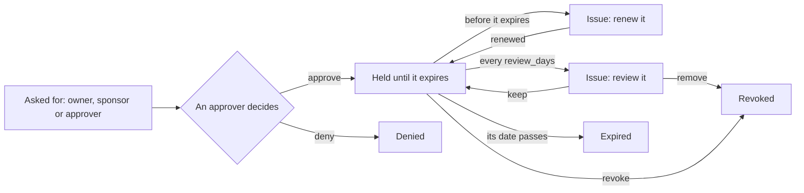

# Access packages

A blueprint gives a class of agents what they always need. Some needs only last a while: an
agent that fixes customer records during an incident, one that tries bigger models for a
quarterly analysis, one that calls another team's agent during a pilot. An **access package**
grants that for a while: an agent's owner, a sponsor or an approver asks for it, an approver
decides, and the agent holds it until it expires. Before then, the people responsible for the
agent are told, so they can renew it.

It is the same idea as access packages in Microsoft Entra ID Governance, for AgentGov's own
grants. For Entra's access packages and agents' Entra identities, see
[microsoft-connections.md](microsoft-connections.md).



## What a package grants

A package grants what a blueprint does: tools, models and other agents to call. Agents get
it on top of their blueprint's grants and their own.

```yaml
apiVersion: agentgov/v1alpha1
kind: AccessPackage
metadata:
  name: crm-write
spec:
  description: Change customer records during an incident
  permissions: [{server: crm, tools: [update_customer]}]
  model_access: [{provider: openai, models: [gpt-4.1]}]
  agent_access: [billing-agent]
  duration_days: 30
  approval: true
  review_days: 14
  blueprints: [support]
```

| Field | What it is |
|---|---|
| `permissions` | Tool grants, as a blueprint's: `server` and `tools`, with `*` wildcards |
| `model_access` | Models, as a blueprint's: `provider` and `models` |
| `agent_access` | Agents it lets the agent call over [A2A](agent-to-agent.md), by name or pattern |
| `duration_days` | How long an assignment lasts at most, from 1 to 365 days (90 by default). A request can ask for less |
| `approval` | Whether an approver decides each request (`true`, the default), or it is granted as soon as someone allowed asks |
| `review_days` | Whether, and how often, its holders are asked if their agents still need it |
| `blueprints` | The blueprints whose agents may hold it. Empty: any agent |

Administrators add packages on **Policies** → **Access packages**, with
`agentgov access-packages create crm-write --grant crm:update_customer --days 30`, with
`POST /v1/access-packages`, or with manifests. A change to a package applies at once to every
agent that holds it. A package can't be deleted while an agent holds it or asks for it.

## Asking, deciding, renewing

| Who | May |
|---|---|
| The agent's owner and sponsors, or members of a team named as either | Ask for packages for it, and review the ones it holds |
| Approvers and administrators | Ask for any agent; decide requests; revoke; review |
| Registrars (CI pipelines) | Ask for any agent |
| Administrators | Assign a package at once (`--approve`), which is recorded as such |
| The `secops` role, from the contain level on | Revoke ([security operations](secops.md)) |

A request says why the agent needs it, and for how many days. Someone other than the person
who asked decides it: approvers can't approve their own requests. An agent asks for a package
once at a time.

Asking again for a package the agent holds is a renewal. Once approved, it carries on from
then for the days asked, and never ends sooner than the one it replaces would have.

| Where | How |
|---|---|
| Admin UI | The agent's page → **Access packages** → **Request access**, **Renew**, **Revoke**; requests wait on **Approvals** → *Access requests*; an issue about a package has **Renew**, or **Keep it** and **Remove it** |
| CLI | `agentgov access-packages request AGENT PACKAGE --reason R [--days N]`, `… approve\|deny ID`, `… revoke ID`, `… review ID --keep\|--remove`, `… assignments [--agent A] [--status S]` |
| API | `POST /v1/access-assignments` with `{"agent", "package", "reason", "days"}`; `POST /v1/access-assignments/{id}/approve\|deny\|revoke\|review`; `GET /v1/access-assignments`, `GET /v1/agents/{ref}/access-packages` |

People without an AgentGov role sign in to ask for and review their agents' packages through
the API and the CLI (`agentgov login`), and act on the issues about them in **Your issues**
([issues](issues.md)).

## Expiry, reminders and reviews

The control plane checks assignments every `AGENTGOV_ISSUES_INTERVAL_SECONDS` (60):

* **Before one expires**, it raises an `access.expiring` [issue](issues.md) about the
  agent, which goes to its owner, then its sponsors, then its team. It is raised in the last
  third of the assignment's time, and at most two weeks before; it grows from low to medium
  severity a week before, and high the last day. Renewing or revoking resolves it.
* **When one expires**, it is `access.expired` in the ledger, and an `access.expired` issue
  asks for it to be renewed or revoked.
* **For packages with `review_days`**, an `access.review_due` issue asks, that often, whether
  the agent still needs it. **Keep it** marks it reviewed; **Remove it** revokes it.

## What an expired package does

How strictly expiry applies is the **access-packages** feature ([features](features.md)):

| Mode | An expired package |
|---|---|
| `enforce` | Grants nothing. Calls that need it are refused, and its tools are hidden from `tools/list` |
| `monitor` (default) | Still grants what it did. Each call that needs it goes through, and the ledger records it as monitored; the `access.expired` issue asks for it to be renewed or revoked |
| `off` | Packages grant nothing at all, expired or not, and can't be asked for. Assignments are kept |

It starts in monitor mode so that no agent loses access by surprise the first time a package
expires: enforce it once its holders renew in time. Revoking takes effect in every mode.

OPA decides expiry itself, to the second, from each package's `expires_at` in the bundle:
an agent loses an expired package's access even before the control plane's next check marks
it expired. Packages only matter where they are what grants the access, so while
`least-privilege` is enforced ([policies](policies.md)).

## In the demo

The example manifests define `crm-export`
([examples/manifests/access-packages.yaml](../examples/manifests/access-packages.yaml)),
which lets support agents export customer records for up to a week. In step 9 of the demo,
`python examples/agents/demo_agent.py`, alice, the agent's sponsor, asks for it; she can't
approve her own request, an administrator does, the agent's export goes through, and once
the package is revoked it is refused again.

## In the ledger

| Entry | When |
|---|---|
| `access_package.created`, `.updated`, `.deleted` | A package changed |
| `access.requested` | Someone asked for a package for an agent (`renews` names what it renews) |
| `access.approved`, `access.denied` | A request was decided (by `system:access-packages` for packages without approval) |
| `access.expired` (warning) | An assignment's time ran out |
| `access.reviewed` | Someone kept it in a review |
| `access.revoked` (warning) | It was revoked, or removed in a review |

Each names the agent, and the package as `access-package/<package>/<agent>`.
