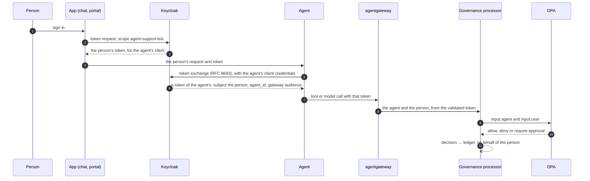

# Acting for people

Many agents act for a person: an assistant answers a question with the data of the person
who asked, a support agent updates a ticket for the colleague it works with. AgentGov
knows who that person is. The agent calls the gateway with a token it got for the person,
and AgentGov:

* passes the person and their groups to policy, so that a blueprint can say whom its
  agents act for, and organisation policies can decide by the person;
* records the person in the ledger with each decision and approval;
* can send the agent's approval requests to the person, who decides them.



## How an agent gets a token for a person

The agent never holds the person's password or their long-lived tokens. It exchanges the
token the person's app gives it for a short-lived token of its own (OAuth 2.0 Token
Exchange, [RFC 8693](https://www.rfc-editor.org/rfc/rfc8693)), which names the person as
its subject and the agent as the client it was issued to.

### Token exchange (Keycloak's standard token exchange)

Keycloak lets a client exchange only tokens issued for it. So for each agent that may act
for people, AgentGov keeps a **client scope named after the agent's client ID**, which
adds the agent to a token's audience. The apps people use agents from ask for that scope
when the person signs in:

1. Name the apps' Keycloak clients in `AGENTGOV_PEOPLE_APP_CLIENTS` (comma-separated; in
   Helm, `peopleApps`). AgentGov offers them each agent's scope as an optional client
   scope, and keeps that up to date as agents come and go.
2. The app signs the person in with `scope=openid agent-support-bot` (the agent's client
   ID). With consent required on the app's client, Keycloak asks the person "Let
   support-bot act for you".
3. The agent exchanges the person's token with its own client credentials:

```python
import httpx

token = httpx.post(
    "https://keycloak.example.com/realms/agentgov/protocol/openid-connect/token",
    data={
        "grant_type": "urn:ietf:params:oauth:grant-type:token-exchange",
        "subject_token": person_token,  # from the app
        "subject_token_type": "urn:ietf:params:oauth:token-type:access_token",
        "requested_token_type": "urn:ietf:params:oauth:token-type:access_token",
    },
    auth=(client_id, client_secret),  # the agent's, from agentgov agents credentials
).json()["access_token"]
```

The token lasts five minutes, without a refresh token: the agent exchanges the person's
token again for each new task. AgentGov enables the exchange on each agent's Keycloak
client, unless its blueprint says the agent acts only on its own.

### Delegation (Keycloak's preview)

Keycloak 26.8 also has a preview of delegation: the person consents to a particular
agent acting for them, and the agent's token names the agent in an `act` claim. AgentGov
records such calls as delegated, with the agent the person delegated to. To try it:

1. Turn on Keycloak's `token-exchange-delegation` and `parameterized-scopes` features,
   keeping `spiffe`: `KC_FEATURES=spiffe,token-exchange-delegation,parameterized-scopes` in
   Compose, or `keycloak.features` in the Helm chart. (`--features` replaces the list, so
   leaving out `spiffe` turns SPIFFE identity issuers off.)
2. On the app's client, require consent and add the optional client scope
   `delegation:client`. The app asks for `scope=openid delegation:client:agent-support-bot`;
   Keycloak asks the person "Allow agent-support-bot to act on your behalf?", and the
   person's token carries `may_act`.
3. Turn on the realm's admin permissions and give the agent's client the `delegate`
   permission on users: in **Permissions**, a permission for the *Users* resource type,
   scope *delegate*, with a client policy for the agent's client.
4. The agent exchanges the person's token as above, adding its own token as the
   `actor_token` (`actor_token_type` as `subject_token_type`).

AgentGov doesn't set up the preview for you: its settings may change before it is
supported.

### Telling the agent from the person

| The token's | Who the agent acts for | `via` |
|---|---|---|
| Subject is the agent's own service account (`service-account-<client ID>` in Keycloak) | no one: it acts on its own | — |
| Subject is a person, and an `act` claim names the agent | the person, who delegated to the agent | `delegation` |
| Subject is a person, without `act` | the person, whose app handed their token to the agent | `exchange` |
| Subject is a person, and `agentgov_sign_in` is true | the person, who signed in to the agent themselves: a public client on their machine, such as a developer's MCP client ([developer tools](developer-tools.md#signing-in-at-the-gateway)) | `sign-in` |

Whichever it is, the agent is the client the token was issued to (its `agent_id` claim
and `azp`), so its own grants, risk and status apply as always.

For an MCP server outside the gateway, an agent acting for a person gets an identity
assertion for them from AgentGov instead ([below](#mcp-servers-outside-the-gateway)).

## Whom an agent may act for

Each blueprint says whom its agents act for:

| Field | Meaning |
|---|---|
| `acts_for` | `people`: every call must be for a person; `itself`: never for a person, and its agents can't exchange people's tokens; `either` (the default) |
| `people_groups` | When the agent acts for a person, the person must be in one of these Keycloak groups: a top-level group by its name (`support`), any group by its full path (`/emea/sales`). Empty: anyone |
| `approvals_by` | Who decides the approval requests its agents make for a person: `approvers` (the default) or `person` (see below) |

| | How |
|---|---|
| Admin UI | **Policies** → a blueprint's **Edit**, *People* |
| CLI | `agentgov blueprints update customer-support --acts-for people --people-groups support,/emea/sales`; `--all-people` clears the groups |
| API | `acts_for`, `people_groups` and `approvals_by` in `POST /v1/blueprints` and `PATCH /v1/blueprints/{name}` |
| Manifests | The same fields in a `Blueprint`'s spec ([example](../examples/manifests/blueprints.yaml)) |

The `acting-for-people` [feature](features.md) applies these rules to tool calls, the
tools an agent sees when it lists them, model calls, and calls between agents, to the caller
and to the agent called, which acts for the same person from then on. Enforced, other calls are
refused; monitored, they go through and the ledger records what would have been
refused. The agent's page shows whom it acts for.

## In policy

Policies see the person as `input.user`, on tool calls, model calls and calls between agents
alike:

```json
"user": {
  "id": "5c0b…",                          // Keycloak's ID of the person (the token's subject)
  "username": "sam",
  "email": "sam@example.com",
  "groups": ["/support"],
  "roles": ["default-roles-agentgov"],    // the person's realm roles
  "via": "exchange",                      // or "delegation", or "sign-in"
  "actor": "agent-support-bot"            // with delegation: the client delegated to
}
```

`input.user` is missing while the agent acts on its own, unless a delegation it carries
names the person at its head ([agent to agent](agent-to-agent.md#the-chain-of-delegation)).
`data.agentgov.context` adds `ctx.user`, `ctx.user_name` and `ctx.member_of(group)`, which
matches a top-level group by its name and any group by its full path. For example, an
organisation policy:

```rego
package agentgov.custom.contractors

import data.agentgov.context as ctx

deny contains "Agents may not delete records for contractors" if {
	ctx.member_of("contractors")
	startswith(input.resource.name, "delete_")
}
```

To try a call for a person, give **What if** on the Policies page a person and their
groups, or `agentgov policies evaluate --server crm --tool get_customer --agent
support-bot --user sam --groups support`.

## In the ledger

Every decision on a call the agent made for a person, and every approval request, records
the person: `on_behalf_of` holds their username (or email address, or ID), and the
details hold everything policy saw. The ledger's hash covers it.

| | How |
|---|---|
| Admin UI | **Ledger**, *On behalf of*; each entry shows whom the agent acted for |
| CLI | `agentgov ledger tail --user sam` |
| API | `GET /v1/ledger?user=sam` |

A jailbreak issue names the person the prompt came for.

## Approvals sent to the person

Some actions are better confirmed by the person the agent acts for than by an approver
who doesn't know the context: sending an email in their name, or deleting a record they
asked about. With the `approvals-by-person` feature on, a blueprint with
`approvals_by: person` sends its agents' approval requests for a person to that person:

1. The held call's error tells the agent who decides and where: "Approval request apr_…
   is pending for sam to approve at https://agentgov.example.com/ui/#/approvals".
2. The person signs in to AgentGov. While the feature is on, people without an AgentGov
   role can sign in too, and see only the requests sent to them; approvers and
   administrators see theirs under *Waiting for you*.
3. Once the person approves, the agent retries the same call for them, and it goes through
   once.

Administrators can decide any request. Approvers don't decide those sent to a person.
`agentgov approvals list --mine` and `GET /v1/me/approvals` list the requests sent to you.

The person approves what is done in their name, so send their approvals to them for
actions that are theirs to take, such as sending their email. Keep approvers for blueprints
whose agents act on what others own. Whatever holds a call for approval, a tool its server
marks destructive or an organisation policy's `require_approval`, the blueprint decides
who is asked.

An approval is for the person it was requested for: it lets the agent make that call for
that person only, not for someone else or on its own.

## MCP servers outside the gateway

Some MCP servers aren't behind AgentGov's gateway: a SaaS vendor's, or one another team
runs, which takes access tokens from an authorization server of its own. The MCP
specification's *enterprise-managed authorization* lets the enterprise decide which of
them people's clients and agents may reach, without a consent screen per server: the
client trades a token it has for an **identity assertion** from the enterprise's issuer (an
Identity Assertion JWT Authorization Grant, or ID-JAG), and the assertion at the server's
authorization server for an access token.

Keycloak can take ID-JAGs, as an experimental feature, but can't give them, so AgentGov
does: its policies decide which agents get one, for which server and for whom, and the
ledger records each one. The agent's calls then go straight to the server: AgentGov
decides whether the agent gets in, but doesn't see what it does there.

1. **Register the server** with the authorization server it takes tokens from.
2. **Grant it** to the agents that may reach it, as any tool server: a grant on any of its
   tools (`{"server": "wiki", "tools": ["search"]}`) lets the agent get an assertion.
3. **Turn on the `identity-assertions` [feature](features.md).** AgentGov then serves its
   metadata at `<control plane>/.well-known/oauth-authorization-server`, and its public
   key at `<control plane>/oauth2/jwks` (the key is served with the feature off too).
4. **Have the server's authorization server trust AgentGov** ([below](#taking-agentgovs-assertions-keycloak)).

| Field | Meaning |
|---|---|
| `authorization_server` | The issuer of the authorization server the tool server takes access tokens from, exactly as it names itself: each assertion's audience. Only for servers outside the gateway (`gateway: false`), with their `url`: agents reach a server on the gateway through it, with their AgentGov token |
| `oauth_client_id` | The client AgentGov's agents are at that authorization server, which each assertion names. By default each agent's own client ID |

| | How |
|---|---|
| Admin UI | **Tool servers** → **Register tool server** or **Edit**, *Outside the gateway* |
| CLI | `agentgov toolservers create wiki --url https://wiki.example.com/mcp --no-gateway --authorization-server https://id.wiki.example.com/realms/wiki --oauth-client-id agentgov-agents` |
| API | `authorization_server` and `oauth_client_id` in `POST /v1/toolservers` and `PATCH /v1/toolservers/{name}` |
| Manifests | The same fields in a `ToolServer`'s spec ([example](../examples/manifests/toolservers.yaml)) |

An agent asks AgentGov's token endpoint with the token it has for the gateway, its own or
one it got for a person (OAuth 2.0 Token Exchange, RFC 8693):

```http
POST /oauth2/token
Content-Type: application/x-www-form-urlencoded

grant_type=urn:ietf:params:oauth:grant-type:token-exchange
&requested_token_type=urn:ietf:params:oauth:token-type:id-jag
&subject_token=<its token for the gateway>
&subject_token_type=urn:ietf:params:oauth:token-type:access_token
&audience=https://id.wiki.example.com/realms/wiki
&resource=https://wiki.example.com/mcp
```

AgentGov checks the token with Keycloak's keys (it must be for the gateway; an ID token
Keycloak issued for the agent's client is taken too, as `...:token-type:id_token`: one
Keycloak marks as an ID token, for that client alone), finds
the server registered with that authorization server (and that `resource`, when several
share it), and asks its policies (`data.agentgov.idjag.decision`). The agent must be
active and the server approved; and the controls apply as their modes say, as they do to
tool calls: least privilege (a grant on the server), access packages, whom its blueprint
lets it act for, and risk-based access. It answers with the assertion:

```json
{"access_token": "<the ID-JAG>", "issued_token_type": "urn:ietf:params:oauth:token-type:id-jag",
 "token_type": "N_A", "expires_in": 300}
```

or with why not: `{"error": "invalid_target", "error_description": "No tool of wiki is
granted to agent helper"}`. The assertion is signed with a P-256 key AgentGov derives from
the service token (ES256, `typ` `oauth-id-jag+jwt`):

| Claim | |
|---|---|
| `iss` | AgentGov: `AGENTGOV_PUBLIC_URL` |
| `sub` | The person the agent acts for (their ID in AgentGov's Keycloak realm), or the agent's own service account when it acts on its own |
| `aud` | The authorization server |
| `client_id` | The agent's client there |
| `resource`, `scope` | The server, and the scopes asked for, if any |
| `act` | The agent, when it acts for a person |
| `email` | The person's, if they have one |
| `jti`, `iat`, `exp` | Its ID, to be used once, and at most five minutes (`AGENTGOV_ASSERTION_LIFETIME_SECONDS`) |

The agent trades it at the authorization server for an access token (RFC 7523:
`grant_type=urn:ietf:params:oauth:grant-type:jwt-bearer&assertion=<the ID-JAG>`, as its
client there), and calls the server with that. The ledger records every assertion given or
refused as `decision.assertion`, with the agent, the person, the server and the
assertion's ID and expiry; the security team's tools get them as API Activity events.

### Taking AgentGov's assertions (Keycloak)

Keycloak 26.7 and later take ID-JAGs with the experimental `identity-assertion-jwt`
feature, on top of its JWT authorization grant (RFC 7523). In the realm that guards the
server (checked with Keycloak 26.8):

1. Start Keycloak with `--features=identity-assertion-jwt`.
2. Add an identity provider for AgentGov of the type *JWT Authorization Grant*
   (`jwt-authorization-grant`): AgentGov's issuer (`AGENTGOV_PUBLIC_URL`), its keys
   (`<control plane>/oauth2/jwks`, or the public key and its key ID), the grant on,
   assertions used once, and at most 300 seconds.
3. Add a confidential client for AgentGov's agents (the server's `oauth_client_id`) with
   the grant on and that identity provider allowed (the attributes
   `oauth2.jwt.authorization.grant.enabled` and `oauth2.jwt.authorization.grant.idp`).
4. Link each person to that identity provider, with their ID in AgentGov's realm as their
   user ID there: Keycloak takes assertions only for people it finds this way.

Keycloak then refuses an assertion used twice, for another client or another audience, or
for someone it can't find. It doesn't check `resource`, nor the longest lifetime it is set
to allow, so AgentGov keeps its assertions short. `tests/test_assertions.py` runs this
against Keycloak 26.8 where Docker is available.

### Limits of identity assertions

* The ID-JAG specification is an IETF draft (draft-ietf-oauth-identity-assertion-authz-grant),
  on which MCP's enterprise-managed authorization builds.
* MCP clients that ask the same issuer that signs people in for their assertions, such as
  VS Code's enterprise-managed authorization, need one issuer for both: AgentGov gives the
  assertions, and Keycloak signs people in. Agents, and clients that can ask an issuer of
  their own, use AgentGov's.
* AgentGov decides whether an agent gets in, and records it; the calls it then makes don't
  pass the gateway, so AgentGov doesn't check or see them.

## Trying it

The Compose stack and the Helm chart (with `keycloak.demoUsers`) come with a demo app
client, `agentgov-demo-chat`, and a person, **sam**, in the group `support`, whose password
is the demo users'. In step 11 of the demo, `python examples/agents/demo_agent.py` signs sam
in to the demo app,
has its agent act for sam through the gateway, and has sam sign in to AgentGov to approve
what the agent wants to do. In step 24, a developer's MCP client gets an identity assertion
for the wiki, a server outside the gateway
([examples/manifests/toolservers.yaml](../examples/manifests/toolservers.yaml)), and
another person's is refused.

## Limits

* AgentGov tells a person from the agent's own service account by Keycloak's naming of
  service accounts, and from `act`. People's tokens come from AgentGov's Keycloak realm:
  federate your directory into it ([signing in](deploy/local.md#signing-in)).
* A person decides their requests when AgentGov's sign-in uses the Keycloak realm that
  issues the agents' tokens, so that the IDs match.
* Groups reach policy from Keycloak's group mapper on each agent's client, as full paths.
* The person's tokens and their exchange are Keycloak's: AgentGov sets up the clients and
  scopes, and the apps and agents do the exchange.
* Developers' own MCP clients go through the gateway with their own token by signing in
  to an agent registered as a public client
  ([developer tools](developer-tools.md#signing-in-at-the-gateway)).
