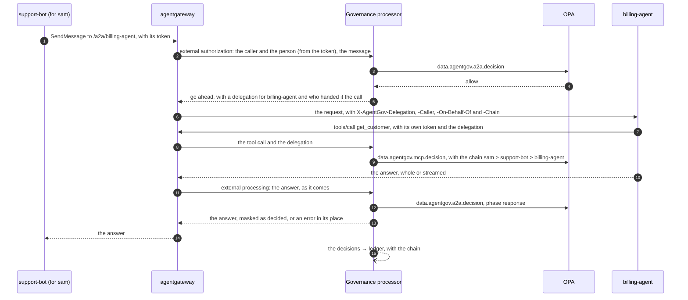

# Agent to agent

Agents hand work to other agents: a support agent asks a billing agent what a customer
owes, an orchestrator sends tasks to specialists. With A2A (the Agent2Agent protocol,
[v1.0](https://a2a-protocol.org/latest/specification/)) they do it the same way whatever
built them. AgentGov puts those calls through the gateway, as it does tool and model
calls, and:

* decides each call with policy: who may call whom, and the controls that apply to tool
  calls (least privilege, data protection, acting for people, risk, approvals), and masks
  the personal data in the message as you choose;
* tells the agent called who handed it the work, and carries that on: the calls it makes
  for the work, to tools, models and other agents, carry the chain of agents that handed
  it down, with the person at its head, to policy and to the ledger;
* checks the answer as it streams back, as it checks tool results: credentials and
  personal data are masked, and instructions aimed at the agent that asked are withheld;
* looks for calls that go around the gateway, straight to an agent's own URL, which it
  doesn't see and can't stop, and tells the agents' owners: agents can refuse those, with
  the delegation the gateway gives with each call ([calls around the
  gateway](#calls-around-the-gateway)).



## Agents that serve A2A

An agent that serves A2A has an `a2a_url` in the registry: its A2A endpoint (the JSON-RPC
binding), which only the gateway should reach ([calls around the
gateway](#calls-around-the-gateway)). With the `a2a-gateway`
[feature](features.md) on (the default), AgentGov publishes it on agentgateway at
`/a2a/<agent>`:

| Gateway | |
|---|---|
| `GET /a2a/billing-agent/.well-known/agent-card.json` | Its agent card. The gateway gives callers its own address in the card's `supportedInterfaces`, so that their A2A clients call it through the gateway |
| `POST /a2a/billing-agent` | Its A2A methods: `SendMessage`, `SendStreamingMessage`, `GetTask`, `ListTasks`, `CancelTask`, `SubscribeToTask` and the others |

Callers authenticate with their AgentGov token, as for tool and model calls (while the
`unknown-callers` feature monitors, others get through, and are recorded and added as unmanaged agents).
Active and blocked agents are published: calls to a blocked agent are refused with a
reason. Agents waiting for approval, unmanaged or deleted aren't, nor agents on the
platforms AgentGov inventories (Microsoft 365, Copilot Studio): the agent's page says why.
With the feature off, no agent is published, and the registry keeps their A2A endpoints.

| | How |
|---|---|
| Admin UI | **Agents** → an agent's **Edit**, *Agent to agent*, *A2A endpoint*. Its page shows where agents call it, its card, whom it may call and who may call it |
| CLI | `agentgov agents update billing-agent --a2a-url http://billing-agent:9600` (`--no-a2a` to stop); `agentgov agents a2a billing-agent` |
| API | `a2a_url` in `POST /v1/agents` and `PATCH /v1/agents/{name}`; `GET /v1/agents/{name}/a2a` |
| Manifests | `a2a_url` in an `Agent`'s spec ([example](../examples/manifests/agents.yaml)) |

## Who may call whom

`agent_access` lists the agents an agent may call, by name or pattern (`billing-*`): a
blueprint's for all its agents, and an agent's own on top of its blueprint's, as with tool
grants.

| | How |
|---|---|
| Admin UI | **Policies** → a blueprint's **Edit**, *Agent to agent*; **Agents** → an agent's **Edit**, *Extra agents it may call*. The **Agent map** draws an arc from each agent to the agents it may call, and in red to those it called without a grant |
| CLI | `agentgov blueprints update customer-support --agent-access billing-agent`; `agentgov agents update support-bot --agent-access kb-*` (`--no-agent-access` to clear) |
| API | `agent_access` in blueprints and agents; `effective_agent_access` on an agent |
| Manifests | `agent_access` in a `Blueprint`'s or an `Agent`'s spec ([example](../examples/manifests/blueprints.yaml)) |

These rules always apply:

* the agent calling and the agent called are registered and active, and the agent called
  serves A2A;
* no agent calls itself, nor an agent already in the chain (a loop);
* a chain holds at most five agents, the caller and the agent called included.

The controls apply as their features say: enforced, they refuse; monitored, the call goes
through and the ledger records what they would have done.

| Control | On a call between agents |
|---|---|
| `least-privilege` | The caller may call the agents its `agent_access` names, or an [access package](access-packages.md) it holds |
| `access-packages` | Calls only an access package that has expired allows are refused (enforced) or recorded (monitored) |
| `data-protection` | A message with credentials is refused. Personal data is found and recorded |
| `acting-for-people` | The caller acts for the person as its blueprint allows, and so must the agent called, which acts for that person from then on |
| `risk-based-access` | No agent at critical risk calls another, or is called |
| `approvals` | An organisation policy's `require_approval` holds the call for an approver (or the person, with `approvals_by: person`); the caller sends the same message again once it is approved |

## The chain of delegation

When the gateway passes a call on, AgentGov gives the agent called a **delegation**: a
token in the `X-AgentGov-Delegation` header, signed by AgentGov, for that agent only, that
lasts an hour. It names the agents that handed the work down, in order, and the person at
their head when the work is for a person.

The agent sends it back with the calls it makes for that work, to tools, models and other
agents, as a header beside its own token:

```python
headers = {
    "Authorization": f"Bearer {own_token}",  # the agent's own token, as always
    "X-AgentGov-Delegation": request.headers["X-AgentGov-Delegation"],  # what it was given
}
```

AgentGov checks it: signed by AgentGov, not expired, given to the agent that sends it, and
for the same person as the agent's token, if its token is for one. Then:

* policy sees the chain as `input.chain`, and the person at its head as `input.user`, even
  when the agent calls with a token of its own;
* the ledger records the chain with each decision, with the delegation's ID and its
  parent's.

A delegation AgentGov didn't give, an expired one, another agent's, or one for another
person gets the call refused. A call without one is the agent's own work.

The gateway also tells the agent called, in plain headers:

| Header | |
|---|---|
| `X-AgentGov-Caller` | The agent that called it |
| `X-AgentGov-On-Behalf-Of` | The person at the head of the chain, if any |
| `X-AgentGov-Chain` | The chain so far, such as `sam > support-bot` |

AgentGov sets all four on every call it passes on, over any a caller sent, so an agent
called through the gateway can rely on them: the gateway drops the plain ones a caller
sends as the call arrives, and with them every other header named as AgentGov's (those
it tells its processor, from the caller's token). Agents can carry the delegation without
reading it, as OAuth
[transaction tokens](https://datatracker.ietf.org/doc/draft-ietf-oauth-transaction-tokens/)
carry the context of a request between workloads: it is a JWT that AgentGov's processors
sign (ES256) with a key derived from `AGENTGOV_SERVICE_TOKEN`. The control plane publishes
the key's public half, so an agent can check it too, and refuse calls that didn't come
through the gateway ([below](#agents-that-refuse-calls-around-the-gateway)).

## Messages

What one agent sends another goes through the processor before the agent called gets it:
the call's check, above, sees the message as it was sent. Credentials in a message stop the
call (`data-protection`). Personal data in it is found and recorded, and masked as the
`a2a-masking` [feature](features.md) says:

| `a2a-masking` | Personal data in a message |
|---|---|
| enforce | Masked before the agent called gets it, unless that agent may have it (its `pii-access` label, or its blueprint's) |
| monitor (the default) | Goes as it is; the call's decision records what would have been masked (`a2a-masking: would mask pii`) |
| off | Goes as it is; recorded |

It starts monitored because an agent often needs what it is sent: see on real traffic what
would be masked, label the agents that need personal data `pii-access`, then enforce it.
Enforced, the gateway also sends each message through external processing, after the
call's check, which masks it on its way; the call's decision says what was masked
(`redacted` in `decision.a2a.request`).

## Answers

The agent called answers the agent that asked through the gateway too, and the processor
checks each answer as agentgateway hands it over (external processing), with the controls
that check tool results:

| Found in an answer | With the control enforced | Monitored |
|---|---|---|
| Credentials | Masked (`data-protection`) | Recorded |
| Personal data | Masked, unless the agent that asked may have it (its `pii-access` label) | Recorded |
| Instructions aimed at the agent that asked (by the rules, or the [classifier](detection.md)) | Withheld (`prompt-injection`): a JSON-RPC error with the answer's ID takes its place | Recorded, and an issue |

So data an agent may see, because its blueprint lets it, doesn't reach the agents it
answers that may not: in the demo, billing-agent reads customers' contact details, and
its answer reaches the support agent with them masked.

* **Streamed answers stay streamed.** Each event (a status update, a message, an
  artifact) is checked as soon as it is whole, and goes on at once. A withheld event is
  replaced by an error, and nothing after it passes.
* **Whole answers are held until their end**, and so is each event, up to 4 MiB; past
  that, an answer is withheld while a control that looks at answers is enforced, and
  passes unchecked otherwise.
* **Whatever their label.** A2A's clients read JSON whatever the content type says, so
  the gateway looks at every answer: a JSON-RPC answer in its result or its error, other
  JSON (A2A's REST binding) whole. The agent's card, failures, and answers that aren't
  JSON (gRPC's among them) pass as they are.
* **Plain, not compressed.** The gateway asks the agent for answers that aren't
  compressed. One compressed anyway can't be read, and counts as one too long.
* What was found in an answer is an issue about the agent that answered, and adds to its
  risk score: `agent.prompt_injection_in_answers`, `agent.credentials_in_answers`.

## Calls around the gateway

AgentGov checks the calls that come through its gateway. It doesn't own the network your
agents run on: an agent, or anything else, that can reach another agent's own A2A URL can
call it there, and nothing above applies to that call. AgentGov can't stop such calls.
What can:

* **the network**: let only the gateway reach agents' A2A endpoints. In Kubernetes, a
  NetworkPolicy in the agent's namespace
  ([example](../examples/kubernetes/agent-network-policy.yaml)); elsewhere, a firewall
  rule, or a listener only the gateway can reach;
* **the agent**: refuse calls without a delegation from AgentGov. The gateway gives one
  with each call it lets through; a call around it has none.

What AgentGov does is find out, and tell the agents' owners.

### Agents that refuse calls around the gateway

A delegation is a JWT that AgentGov signs (ES256) moments before the gateway passes the
call on, for the agent called, by its name and its AgentGov ID. The control plane publishes
the public key, which is no secret, at `GET /v1/delegations/jwks` (a JSON Web Key Set;
`GET /v1/info` names it as `delegation_jwks`). A Python agent that serves A2A over ASGI
(Starlette, FastAPI) needs one line, with
[agentgov.a2a_auth](../src/agentgov/a2a_auth.py), which needs only PyJWT (copy the file into
an agent that doesn't install AgentGov):

```python
from agentgov.a2a_auth import RequireDelegation

app = RequireDelegation(
    app, agent="billing-agent", jwks_url="https://agentgov.example.com/v1/delegations/jwks"
)
```

A call without a valid delegation gets HTTP 401 and a JSON-RPC error. The agent's card stays
open, and so do the paths you name (`open_paths`, such as its health checks). A call with
one has the delegation's claims in `request.scope["state"]["agentgov_delegation"]`. Any JWT
library does the same, as the demo's billing-agent does with PyJWT
([server.py](../examples/agents/billing/server.py)):

| Check | |
|---|---|
| Signature | ES256, with the key in AgentGov's key set that the token's `kid` names. Keep the set for a few minutes, and read it again for a `kid` you don't know (the service token changed), but not for every such call |
| `iss` | `agentgov` |
| `aud` | The agent's name, or its AgentGov ID: the token holds both |
| `exp` | Not passed. A delegation lasts an hour, for the calls the agent makes for the work |
| `iat` | Within the last two minutes or so: the gateway gives one with each call, so an older one came another way |
| `jti` | Not taken before. The agent sends its delegation on with its calls for the work, so the tool servers and models it calls see it: one could send it back to the agent around the gateway. Keep the `jti`s taken for as long as the `iat` check would take them |

Read the key set over HTTPS, at the control plane's public address: whoever can change it
on its way can make delegations the agent accepts.

### Telling AgentGov, and finding out

Each agent's owners say what stops calls around the gateway to it (`a2a_protection`): the
`network`, or the agent, checking the `delegation`.

| | How |
|---|---|
| Admin UI | Agent → **Edit** → *Agent to agent* → *Calls around the gateway are stopped by*. Its page shows what its owners said, and what AgentGov's test found |
| CLI | `agentgov agents update billing-agent --a2a-protection delegation` (`--no-a2a-protection` for neither); `agentgov agents a2a billing-agent` |
| API | `a2a_protection` in `POST /v1/agents` and `PATCH /v1/agents/{name}`; `around_gateway` in `GET /v1/agents/{name}/a2a` |
| Manifests | `a2a_protection` in an `Agent`'s spec ([example](../examples/manifests/agents.yaml)) |

The `calls-around-gateway` [feature](features.md) says how AgentGov looks for such calls,
to the agents published on the gateway. Its issues go to the agents' owners as
[issues](issues.md):

| Mode | |
|---|---|
| `watch` (the default) | Telemetry that shows a call straight to an agent's A2A URL is recorded in the ledger (`telemetry.a2a_around_gateway`), and raises an issue for the owners of the agent called (`agent.a2a_called_around_gateway`) and, when a registered agent made the call, for its owners (`agent.a2a_calls_around_gateway`). An agent whose owners haven't said what stops such calls raises a low one (`agent.a2a_protection_undeclared`). AgentGov calls no agent itself |
| `test` | As `watch`, and each posture scan also calls each agent's A2A URL itself, without a delegation, as a call around the gateway would: a `GetTask` for a task that doesn't exist, which changes nothing, with the header `X-AgentGov-Check: calls-around-gateway`. An agent that takes the call raises `agent.a2a_reachable_around_gateway`: medium, or high if its owners said something stops such calls. The agent's page shows what the last test found, and the ledger records each change (`agent.a2a_tested`). It needs `posture-checks` on |
| `off` | Nothing is looked for. What owners said is kept; issues already raised stay open, marked unverified |

Telemetry shows a call around the gateway as a client span whose `server.address` and
`server.port`, or `url.full`, name an agent's A2A URL (a Kubernetes service by its short or
its long name). The test finds:

| Found | |
|---|---|
| `refused` | The agent refused a call without credentials (HTTP 401 or 403). It checks AgentGov's delegation, or credentials of its own; only the delegation shows that a call came through the gateway |
| `accepted` | It answered (HTTP 2xx): whoever can reach it can call it around the gateway |
| `unreachable` | AgentGov couldn't reach it, as the network should keep out every caller but the gateway. The test runs from the control plane: it shows what the control plane can reach, not what every agent can |
| `inconclusive` | It answered something else (it may not serve JSON-RPC there), or its certificate couldn't be verified |

## In policy

The processor asks `data.agentgov.a2a.decision`:

```json
{
  "kind": "a2a",
  "method": "SendMessage",
  "agent": {"agent_id": "agt_…", "client_id": "agent-support-bot"},
  "target": "billing-agent",
  "user": {"id": "5c0b…", "username": "sam", "groups": ["/support"], "via": "exchange"},
  "chain": [{"type": "person", "id": "5c0b…", "name": "sam"}],
  "detections": {"categories": [], "entities": []}
}
```

For an answer, the input has `"phase": "response"` and `"method": "answer"`, and its
`detections` hold what was found in it, `prompt_injection` included; the decision's
`redact` lists what to mask. Organisation policies tell calls between agents by
`input.kind == "a2a"`, and read `input.chain` on tool and model calls too:

```rego
package agentgov.custom.payments

import data.agentgov.context as ctx

# Only work a person started reaches the payments agent.
deny contains "Calls to payments must come from a person's request" if {
	input.kind == "a2a"
	input.target == "payments"
	not ctx.user
}

# Refunds handed down by another agent wait for an approver.
require_approval contains "Refunds another agent asked for need an approver" if {
	input.resource.name == "refund"
	some link in input.chain
	link.type == "agent"
}
```

To try a call, choose **A call to another agent** in **What if** on the Policies page, or
`agentgov policies evaluate --agent support-bot --call-agent billing-agent --user sam`.

## In the ledger and the SIEM

| Entry | |
|---|---|
| `decision.a2a.request` | A call between agents: the caller is the agent, the agent called the resource, the A2A method the action, and the person in `on_behalf_of`. Its details hold the A2A context and task, the whole chain (ending with the agent called) and the delegation it gave (`uid`) with its parent's (`parent_uid`) |
| `decision.a2a.response` | An answer in which something was found, masked or withheld (clean answers aren't recorded): what was found, what was masked, and the agent that answered. The trace links it to its call |
| `decision.request`, `decision.model.request`… | A tool or model call made under a delegation holds the chain, ending with the agent calling, and the delegation's IDs |

[Security operations](secops.md) hands both to SIEMs as OCSF API Activity: the agent
called as the `api.service` and a `resources` entry of type `AI Agent`, the A2A context in
`message_context`, and OCSF's `delegation` object (`uid`, `parent_uid`, and `issuer_uid`
`agentgov`).

| | How |
|---|---|
| Admin UI | **Ledger**, each entry with its chain; **Agent map**, calls between agents in the last 30 days and how many were refused |
| CLI | `agentgov ledger tail --type 'decision.a2a.*'` |
| API | `GET /v1/ledger?type=decision.a2a.request`; `GET /v1/graph` |

## Trying it

The Compose stack runs **billing-agent** ([examples/agents/billing](../examples/agents/billing/server.py)),
an A2A agent with no secret (it authenticates with its service account token from the
demo cluster) that looks customers up in the CRM through the gateway. The
`customer-support` blueprint's agents may call it. Step 12 of
`python examples/agents/demo_agent.py`:

1. the demo agent, acting for sam, reads billing-agent's card through the gateway, and
   asks it what a customer owes, claiming to act for someone else;
2. billing-agent answers, and says who asked and for whom: the demo agent, for sam; the
   customer's contact details it read reach the demo agent masked; and with `a2a-masking`
   enforced, an email in what the demo agent asks reaches billing-agent whole, as it may
   have personal data;
3. the ledger holds the call between the agents, and billing-agent's own call to the CRM,
   each with the chain `sam > demo-agent-… > billing-agent`;
4. a delegation the demo agent made up is refused;
5. without its blueprint's grant, the demo agent's call is refused;
6. with `calls-around-gateway` on `test`, AgentGov calls billing-agent at its own URL, and
   billing-agent refuses the call: it carries no delegation; and telemetry from a job that
   called billing-agent there raises an issue for billing-agent's owners.

## Limits

* Personal data in a message an agent sends is masked only while `a2a-masking` is
  enforced. A call the processor can't read (compressed, not one JSON-RPC call, such as
  a batch or another binding, or with `params`, `message` or `parts` spelled in another
  case, which some servers read all the same) is refused while `data-protection` is
  enforced, and goes on otherwise, its decision saying what wasn't checked.
* The processor reads each request whole, up to 256 KiB: agentgateway refuses larger ones
  (HTTP 413) before they reach policy.
* Calls that go around the gateway aren't governed, and AgentGov can't stop them: the
  network or the agent must ([calls around the gateway](#calls-around-the-gateway)). The
  plain headers are only as trustworthy as that.
* A call the gateway can't check (the processor or OPA down) goes through unchecked while
  no control at the gateway is enforced, or while `AGENTGOV_GATEWAY_FAILURE_MODE` is open
  ([when something is down](features.md#when-something-is-down)). It carries no
  delegation from AgentGov for the agent called (only the caller's own, if it sent one)
  and none of the plain headers, so agents that refuse calls without one refuse it too.
  While answers are checked (`data-protection` or `prompt-injection` on), agentgateway 1.6
  answers such a call 500 when it can't reach the processor with the answer, whatever the
  failure mode: the agent called has had the call by then.
* A delegation is a bearer token: whoever holds one can present it until it expires. The
  agent it was given to holds it, and sends it with its calls through the gateway, where
  the tool servers and models it calls see it too; the `iat` and `jti` checks above keep an
  agent from taking it as proof for a later call, or for a call around the gateway.
  `agentgov.a2a_auth` keeps the `jti`s it took in memory: an agent with several replicas
  refuses a second use on the replica that took the first.
* The gateway routes the JSON-RPC binding. Push notifications, the agent calling a
  caller's webhook back, don't go through it.
* Delegations are signed with a key derived from the service token: changing
  `AGENTGOV_SERVICE_TOKEN` ends the delegations in flight, which last an hour at most, and
  changes the published key (its `kid`). Delegations signed before agents could check
  them (HS256) are still accepted by AgentGov until they expire.
