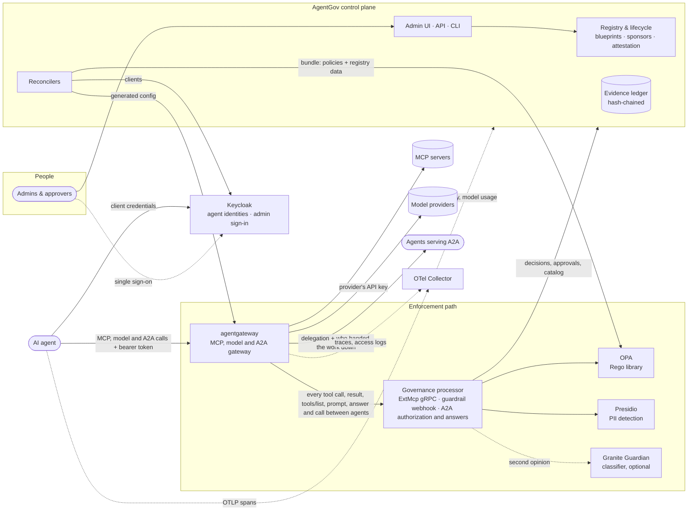
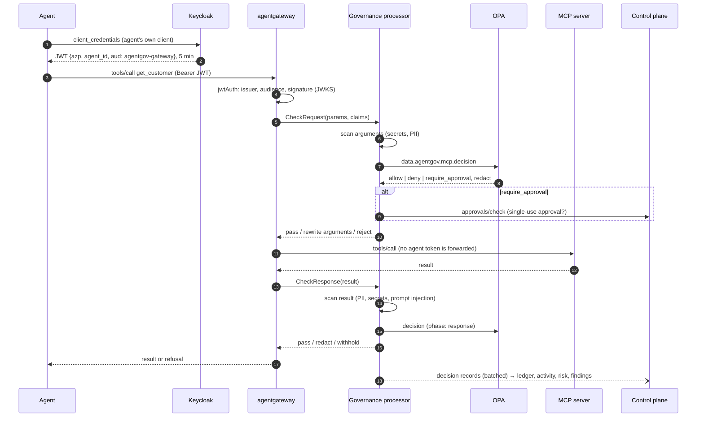

# Architecture

AgentGov is a **control plane** composed from established open-source projects. It
adds only what none of them provides: an agent registry with lifecycle governance,
and the glue that keeps the identity provider, policy engine and gateway in sync with it.

## Components

| Component | Role | Agent 365 analogue |
|---|---|---|
| **Control plane** (this repo, `agentgov server`) | Registry, lifecycle, approvals, findings, risk, evidence ledger, API, UI; serves OPA bundles; writes gateway config; provisions Keycloak clients; reads agents from Microsoft 365, Copilot Studio and Entra Agent ID, and their use and alerts from Purview and Defender; answers Copilot Studio's threat-detection calls ([platforms](platforms.md), [connections](microsoft-connections.md)); sends the ledger to SIEMs as OCSF events and alerts to Teams and Slack ([security operations](secops.md)) | Microsoft 365 admin center *Agents*, Entra ID Governance, Defender's SIEM connectors |
| **Governance processor** (this repo, `agentgov processor`) | agentgateway's MCP-aware external policy server, its guardrail webhook for model calls, and its external authorization for calls between agents and external processing for their answers: content inspection, OPA queries, approvals, redaction, the delegations agents pass on, decision records | Defender real-time protection, Purview DLP enforcement |
| [Keycloak](https://www.keycloak.org) 26.8 | One OAuth client per agent; issues short-lived tokens with `agent_id` and the gateway audience, for the agent itself or, by token exchange, for a person it acts for ([acting for people](acting-for-people.md)); takes agents' own identities, Kubernetes service account tokens, SPIFFE JWT-SVIDs or other OpenID Connect issuers' tokens, in place of client secrets ([agents' own identities](agent-identity.md)); signs administrators in to the control plane (and can federate an existing directory). For MCP servers outside the gateway, the control plane gives agents identity assertions (ID-JAG), which those servers' authorization servers, Keycloak among them, trade for access tokens ([acting for people](acting-for-people.md#mcp-servers-outside-the-gateway)) | Entra Agent ID (including federated identity credentials), Entra ID sign-in |
| [OPA](https://www.openpolicyagent.org) 1.21 | Policy decision point; evaluates the Rego library against registry data. Its decisions are also an AuthZEN decision point for other enforcement points, and the processor can ask an AuthZEN decision point of yours beside it ([AuthZEN](policies.md#authzen)) | Conditional Access |
| [agentgateway](https://agentgateway.dev) 1.6 | MCP, model and A2A gateway, and policy enforcement point; validates tokens, calls the processor, routes to MCP servers, to model providers with their API keys ([model calls](models.md)) and to agents that serve A2A ([agent to agent](agent-to-agent.md)) | Agent 365 tooling gateway, Azure API Management's AI gateway |
| [Presidio](https://github.com/data-privacy-stack/presidio) | Personal-data detection | Purview classifiers |
| [OpenTelemetry Collector](https://opentelemetry.io/docs/collector/) | Receives agent and gateway traces, forwards GenAI spans to the control plane (and optionally Langfuse); gateway decisions in the ledger carry the trace ID, so the UI links each one to its trace. Forwards the gateway's access logs of model calls, from which the control plane meters tokens and cost | Agent 365 observability |
| [Agent Governance Toolkit](https://github.com/microsoft/agent-governance-toolkit) (optional) | In-process enforcement inside agent frameworks, querying the same OPA | — |
| [IBM Granite Guardian](https://huggingface.co/ibm-granite/granite-guardian-4.1-8b) (optional) | Judges agents' instructions for harmful or malicious content, and the traffic for prompt injection and jailbreaks, next to AgentGov's rules ([instructions](instructions.md), [detection](detection.md)); served by vLLM or llama.cpp | Defender's AI security posture; Prompt Shields in Azure AI Content Safety |

## The path of a tool call

* **tools/list** responses also pass through the processor: each agent sees only the
  tools its grants allow, poisoned tools are hidden, and the list is marked
  `cacheScope: private` so shared caches cannot leak one agent's view to another.
* Decisions are taken on the JSON-RPC body agentgateway parsed. The `Mcp-Method` /
  `Mcp-Name` headers introduced by the 2026-07-28 MCP revision are never trusted, so a
  client that downgrades to an older protocol cannot spoof the tool name.
* agentgateway reports a refused **call** as an `isError` tool result (so the model can
  read why and adapt) and a withheld **result** as a JSON-RPC error.
* Each control on this path (least privilege, approvals, data protection,
  prompt-injection defence, tool integrity, risk-based access) applies as its
  [feature](features.md) says: enforced, monitored or off. A monitored control lets the
  call through and its decision says what it would have done, which the ledger records
  as a warning. The bundle carries the modes (`data.registry.features`), and the
  processor reads them from OPA, so a change reaches every gateway within seconds.
* A developer's MCP client takes the same path with the developer's own token, once they
  have signed in to an agent registered as a public client: with the `developer-sign-in`
  feature, the route checks tokens with agentgateway's MCP authentication, which also
  serves the server's OAuth protected resource metadata and answers a call without a
  token with where to sign in ([developer tools](developer-tools.md#signing-in-at-the-gateway)).

## The path of a model call

Each approved model provider is a gateway route, `/llm/<provider>/v1/chat/completions`.
The agent calls it with its own token, as it calls tools. agentgateway validates the
token, then sends the prompt to the processor's guardrail webhook (HTTP), with the
agent, the provider and the model in headers it computes from the token and the request.
The processor inspects the prompt (credentials, personal data, instructions injected
through tool results, jailbreaks), asks OPA (`data.agentgov.models.decision`) and answers
pass, masked prompt or refuse. agentgateway sends the prompt on with the provider's API
key, which it reads from a file, and sends the answer through the webhook the same way
before the agent gets it. Its access log of the call (tokens, model, agent) goes through
the OpenTelemetry Collector to the control plane, which meters it per agent against the
agent's daily budget; an agent over budget is in the next bundle, and OPA refuses its
calls. [Model calls](models.md) has the details.

## The path of a call between agents

An agent that serves A2A is a gateway route, `/a2a/<agent>`, whose card agentgateway
points at the gateway. The calling agent sends its A2A request with its own token.
agentgateway validates the token, then asks the processor (external authorization over
HTTP, fail-closed) with the request's JSON-RPC body and headers it computes from the
token: the caller, the person it acts for, and any delegation the caller carries. The
processor checks the delegation, inspects the message, asks OPA
(`data.agentgov.a2a.decision`), and answers go ahead or refuse. Going ahead, it gives the
agent called a delegation of its own, a token signed with a key derived from the service
token (whose public half the control plane publishes, for agents that check it) that names
the chain of agents and the person at its head, and agentgateway passes
it on in headers, over any the caller set. The agent called sends the delegation with
the calls it makes for that work, and the processor puts the chain into policy and the
ledger of each one. While `a2a-masking` is enforced, the message goes through the
processor's external processing too, after the decision, which masks the personal data the
agent called may not have. The answer comes back through the processor too (external
processing over gRPC, fail-closed), event by event when it streams: credentials and personal data in
it are masked, and instructions aimed at the agent that asked are withheld.
[Agent to agent](agent-to-agent.md) has the details.

## A classifier's second opinion

The processor's rules look at every call. Where IBM Granite Guardian is configured, the
processor also asks it about what the rules let through: tool results and agents'
answers (instructions aimed at the agent?) and people's prompts to models (a jailbreak?).
Where the check it supports is enforced, and the classifier too, the call waits for its
verdict, a few seconds at most; otherwise the call goes on and the verdict, given in the
background, is recorded and raises a finding. [Detection](detection.md) has the details.

## Developers' MCP clients

The tool servers listed for developers are also served as an MCP registry, at
`<control plane>/registry` (the MCP Registry API, version 0.1), which GitHub Copilot in
VS Code and other editors reads to offer developers only approved MCP servers.
`agentgov mcp scan --report`, run on developers' machines, reports the MCP servers set
up there, without their credentials, and the control plane raises findings for those
that aren't approved or that skip the gateway. [Developer tools](developer-tools.md)
has the details.

## Keeping components in sync

The registry is the source of truth. Every committed change notifies three reconcilers
(after the transaction commits, never before):

| Change | Reconciler | Effect |
|---|---|---|
| Agent approved, blocked, deleted, restored; a blueprint's `acts_for` changed; an identity issuer added, changed, blocked or deleted; an agent's workload identity changed | Identity | Keycloak client created, enabled or disabled, with token exchange allowed while it may act for people, and its client scope offered to the people's apps; each identity issuer an identity provider, enabled while it is approved, and an agent with a workload identity a client that authenticates with that issuer's token for its subject instead of a secret. After each change, and every 60 s, it syncs the agents whose clients should change (it keeps a digest of what each was last synced to be) or whose last sync failed; every agent at first and every `AGENTGOV_IDENTITY_FULL_SYNC_SECONDS` (15 minutes), which also repairs what was changed in Keycloak itself |
| Anything OPA needs (agents, grants, risk, tool catalog, policies) | Bundle server | New bundle revision; long-polling OPA instances receive it immediately |
| Tool server or model provider added, approved, blocked; an agent that serves A2A approved, blocked or deleted, or its endpoint changed; a feature's mode changed | Gateway config | A sidecar beside the gateway (`agentgov gateway-config`) fetches the generated config from `GET /v1/gateway/config` every few seconds and rewrites agentgateway's file atomically; agentgateway reloads it. The sidecar holds back a model provider's route, which then answers 503, until the provider's API key is there: agentgateway would refuse the whole file otherwise. (The control plane can write the file itself instead, with `AGENTGOV_GATEWAY_CONFIG_PATH`, where it shares a volume with the gateway and can see the keys) |

**Kill switch.** Blocking an agent changes the bundle; OPA, which holds a long-poll
request open on the control plane, activates the new bundle at once, and the next call
is denied. The end-to-end demo measures this at about 0.1 seconds. Keycloak stops
issuing new tokens to the agent; existing tokens are useless because every call is
evaluated against the live status.

## Evidence ledger

Every lifecycle change, admin action, approval, policy decision and OPA decision log
is appended to a hash chain (`hash = sha256(prev_hash ‖ canonical_json(entry))`).
A transaction writes its entries as it commits, after everything else it changed, under a
row lock on the chain head: writers extend the chain one at a time, and the head is the
last row a transaction locks, so two transactions that lock the same rows in another order
take turns rather than deadlock. `GET /v1/ledger/verify` recomputes the chain and reports the first broken entry
(edited, deleted or truncated). The overview's integrity badge checks new entries as they
arrive and re-verifies the whole chain every five minutes. `GET /v1/ledger/export`
streams the ledger as JSON Lines for offline verification
(`agentgov ledger verify --file`). Every day the chain's head is kept as a checkpoint,
which a time-stamping authority signs when one is set (RFC 3161), and which goes into a
transparency log (Sigstore Rekor) when one is set; with a retention period,
older entries are archived, checked link by link, before they leave the database, and the
chain there goes on from the checkpoint at their end ([evidence](evidence.md)).

The security team's tools get the ledger as it grows ([security operations](secops.md)):
a delivery loop in the control plane sends each destination the entries after its
cursor, as OCSF events to SIEMs (OTLP logs, an HTTP input, Splunk's HTTP Event Collector)
and as alerts to Teams and Slack, and moves the cursor once they are accepted. It wakes
when a transaction that wrote to the ledger commits, and every few seconds otherwise.
SIEMs that collect read the same events from `GET /v1/secops/events`.

## Trust boundaries and failure modes

| Boundary | Protection |
|---|---|
| Agent → Keycloak | The agent's client secret, or, for an agent with a workload identity, its workload's token from an approved identity issuer (signature checked with the issuer's keys; issuer, subject, audience and at most an hour of validity) |
| Agent → gateway | Keycloak-issued JWT, audience-bound to the gateway, 5-minute lifetime; for a person, a token the agent got by exchanging the person's (its subject is the person, the agent the client it was issued to) |
| Gateway → MCP server | The agent's token is never forwarded (MCP spec: no token passthrough); servers are only reachable through the gateway |
| Gateway → model provider | The provider's API key, which only the gateway (and its config sidecar) can read, from a file; the agent's token is never forwarded |
| Gateway → agent serving A2A | The caller's token is never forwarded; the agent called gets a delegation and who handed it the work in headers AgentGov sets on every call it passes on. AgentGov doesn't own the network: only the gateway should reach agents' A2A endpoints (a NetworkPolicy in Kubernetes), or the agents refuse calls without a delegation; AgentGov looks for calls around the gateway and tells the agents' owners ([calls around the gateway](agent-to-agent.md#calls-around-the-gateway)) |
| Agent → agent (delegation) | A JWT for the agent called only (its name and ID), signed by the processors (ES256) with a key derived from the service token, whose public half the control plane publishes (`/v1/delegations/jwks`), lasting an hour; checked by AgentGov on each call that carries it (signature, expiry, holder, and the same person as the caller's token), and by agents that check it, on the calls they take |
| Gateway → processor | Mutual TLS: each shows a certificate from AgentGov's own authority, cert-manager or SPIRE ([production](production.md#mutual-tls-between-components)); fail-closed (`failureMode: failClosed`, or `deny` for external authorization) for tool calls (gRPC), model calls (the webhook), calls between agents (external authorization) and their answers (external processing, gRPC) |
| Processor, control plane → OPA | Mutual TLS: OPA asks every caller for a certificate from AgentGov's authority (with SPIRE, the processor's or the control plane's, by their SPIFFE IDs) |
| Processor, control plane → Granite Guardian | Inside your network, like Presidio; they send it the text it judges, with its API key if it has one |
| Control plane → OPA (bundles) | Signed: OPA refuses a bundle that doesn't verify against the control plane's certificate, and keeps the last good one ([production](production.md#signed-bundles)) |
| Components → control plane | Mutual TLS on the control plane's internal port, where a component's certificate is its proof (with SPIRE, only the components it names, by their SPIFFE IDs); the service role is no use on the public port, by the service token or an API key. Admin API keys are scoped by role |
| Copilot Studio → control plane (threat detection) | The only endpoint meant for the internet: a token that Microsoft Entra ID signed (RS256, keys from the tenant's JWKS) for the configured tenant and AgentGov's API, issued to an allowed caller app; anything else gets 401 |
| Control plane → Microsoft | AgentGov's app registration (client credentials, read-only Graph permissions) on a schedule; Power Platform and Graph admin actions only as a signed-in admin, with their delegated token |
| Admins → control plane | Single sign-on: OIDC authorization code flow with PKCE, run by the control plane as a confidential client; the session stays server-side and the browser holds only an HttpOnly, `SameSite=Strict` cookie; writes also need an `X-AgentGov-CSRF` header. Provider roles map to `admin`, `approver`, `secops`, `auditor` and `registrar` (people without one sign in as `person` while `approvals-by-person` is on). A session ends when the provider's does: its signed logout token, posted to `/auth/backchannel-logout`, ends the sessions from it ([administration](administration.md#signing-out-everywhere)). Automation uses role-scoped API keys; the bootstrap admin token is for break-glass access |

| Failure | Behaviour |
|---|---|
| Processor down or erroring | agentgateway refuses governed calls, model calls and calls between agents (fail-closed) |
| A model provider's API key is missing | That provider's route answers 503 until the key is there; the gateway serves its other routes as usual |
| Access logs don't reach the control plane | Model calls go on, unmetered: budgets can't stop an agent whose usage isn't counted |
| OPA unreachable or bundle missing | Processor denies ("policy engine unavailable") |
| Presidio unreachable | Deny by default; `AGENTGOV_PRESIDIO_FAILURE_MODE=open` skips PII scanning instead |
| Granite Guardian unreachable or slow | The rules alone decide. A call that waits for the classifier waits `AGENTGOV_CLASSIFIER_TIMEOUT_SECONDS` at most, and its decision says the classifier didn't answer; instructions to check stay queued until it is back |
| A custom Rego policy fails to compile | Rejected at submission, after a compile and a smoke evaluation, so a broken module never reaches OPA |
| OPA cannot activate a bundle anyway, or it doesn't verify | OPA keeps the last good bundle; its status report raises a critical finding |
| A control-plane replica stops | The others answer; if it led, another takes the scheduled work over within seconds ([production](production.md#several-replicas)) |
| The database restarts during a job | Another replica may start the job; the run that lost its lock stops at its next commit, with nothing more written |
| A replica loses the database for a while | When it finds it again, it acts as if everything changed; meanwhile its bundles are at most a minute old |
| Control plane down | Enforcement continues with the last bundle; decision records queue in the processor and are retried |
| Database schema out of date | The control plane migrates it at start-up (one replica at a time, under a PostgreSQL advisory lock), or, with automatic migration off, refuses to start until `agentgov db upgrade` has run. A schema newer than the version knows stops it with a message |
| Keycloak down | No new tokens; identity drift is reported on the agent and retried |
| Keycloak refuses an identity issuer (a missing role, unreachable keys) | The issuer shows the error and raises a finding, high when a block hasn't reached Keycloak; agents with client secrets are unaffected |
| OPA unreachable during a Copilot Studio threat-detection call | AgentGov answers as `AGENTGOV_COPILOT_STUDIO_ON_ERROR` says (block by default, in enforce mode); if it doesn't answer within a second, Copilot Studio lets the tool run unless the environment is set to block |
| A Microsoft connection fails or lacks a permission | That connection shows the error or the missing permission on the Platforms page; the others and the rest of AgentGov carry on |

## Scaling notes

* SQLite is for development, and one process. Use PostgreSQL (the compose stack does) for
  anything shared.
* The control plane runs as several replicas on PostgreSQL: changes reach every replica
  with the commit (`LISTEN`/`NOTIFY`), one replica at a time runs the scheduled work, and
  nothing lives in one replica's memory ([production](production.md#several-replicas)).
* The processor is stateless and scales horizontally; Presidio is the slowest hop
  (~40 ms per KB of text). Text beyond `AGENTGOV_PRESIDIO_MAX_CHARS` is not sent to it.
* Content scanning is bounded (depth, number of strings, characters) and uses
  linear-time patterns; adversarial 50 KB inputs scan in under 60 ms.
* Granite Guardian, where it is configured, takes a fraction of a second per verdict on a
  GPU and several seconds on a CPU. Each processor asks it a few texts at a time
  (`AGENTGOV_CLASSIFIER_CONCURRENCY`) and remembers its verdicts for ten minutes
  ([detection](detection.md#what-it-costs-and-the-limits-on-it)).

## Repository layout

[CONTRIBUTING](../CONTRIBUTING.md#where-things-live) maps the repository.
