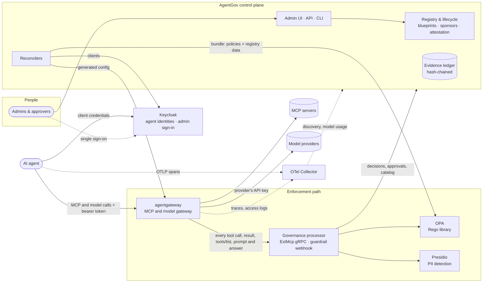
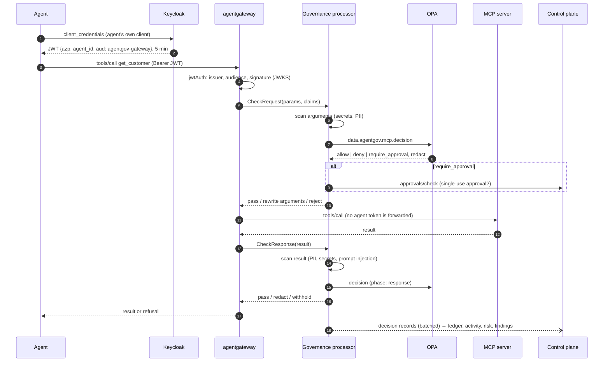

# Architecture

AgentGov is a **control plane** composed from established open-source projects. It
adds only what none of them provides: an agent registry with lifecycle governance,
and the glue that keeps the identity provider, policy engine and gateway in sync with it.



## Components

| Component | Role | Agent 365 analogue |
|---|---|---|
| **Control plane** (this repo, `agentgov server`) | Registry, lifecycle, approvals, findings, risk, evidence ledger, API, UI; serves OPA bundles; writes gateway config; provisions Keycloak clients; reads agents from Microsoft 365, Copilot Studio and Entra Agent ID, and their use and alerts from Purview and Defender; answers Copilot Studio's threat-detection calls ([platforms](platforms.md), [connections](microsoft-connections.md)) | Microsoft 365 admin center *Agents*, Entra ID Governance |
| **Governance processor** (this repo, `agentgov processor`) | agentgateway's MCP-aware external policy server, and its guardrail webhook for model calls: content inspection, OPA queries, approvals, redaction, decision records | Defender real-time protection, Purview DLP enforcement |
| [Keycloak](https://www.keycloak.org) 26.8 | One OAuth client per agent; issues short-lived tokens with `agent_id` and the gateway audience, for the agent itself or, by token exchange, for a person it acts for ([acting for people](acting-for-people.md)); takes agents' own identities, Kubernetes service account tokens, SPIFFE JWT-SVIDs or other OpenID Connect issuers' tokens, in place of client secrets ([agents' own identities](agent-identity.md)); signs administrators in to the control plane (and can federate an existing directory) | Entra Agent ID (including federated identity credentials), Entra ID sign-in |
| [OPA](https://www.openpolicyagent.org) 1.21 | Policy decision point; evaluates the Rego library against registry data | Conditional Access |
| [agentgateway](https://agentgateway.dev) 1.6 | MCP and model gateway, and policy enforcement point; validates tokens, calls the processor, routes to MCP servers and to model providers with their API keys ([model calls](models.md)) | Agent 365 tooling gateway, Azure API Management's AI gateway |
| [Presidio](https://github.com/data-privacy-stack/presidio) | Personal-data detection | Purview classifiers |
| [OpenTelemetry Collector](https://opentelemetry.io/docs/collector/) | Receives agent and gateway traces, forwards GenAI spans to the control plane (and optionally Langfuse); gateway decisions in the ledger carry the trace ID, so the UI links each one to its trace. Forwards the gateway's access logs of model calls, from which the control plane meters tokens and cost | Agent 365 observability |
| [Agent Governance Toolkit](https://github.com/microsoft/agent-governance-toolkit) (optional) | In-process enforcement inside agent frameworks, querying the same OPA | — |
| [IBM Granite Guardian](https://huggingface.co/ibm-granite/granite-guardian-4.1-8b) (optional) | Judges agents' instructions for harmful or malicious content, next to AgentGov's rules ([instructions](instructions.md)); served by vLLM or llama.cpp | Defender's AI security posture |

## The path of a tool call



* **tools/list** responses also pass through the processor: each agent sees only the
  tools its grants allow, poisoned tools are hidden, and the list is marked
  `cacheScope: private` so shared caches cannot leak one agent's view to another.
* Decisions are taken on the JSON-RPC body agentgateway parsed. The `Mcp-Method` /
  `Mcp-Name` headers introduced by the 2026-07-28 MCP revision are never trusted, so a
  client that downgrades to an older protocol cannot spoof the tool name.
* agentgateway reports a refused **call** as an `isError` tool result (so the model can
  read why and adapt) and a withheld **result** as a JSON-RPC error.
* Each control on this path (least privilege, approvals, data protection,
  prompt-injection defence, tool integrity, risk-based access) applies as its
  [feature](features.md) says: enforced, monitored or off. A monitored control lets the
  call through and its decision says what it would have done, which the ledger records
  as a warning. The bundle carries the modes (`data.registry.features`), and the
  processor reads them from OPA, so a change reaches every gateway within seconds.

## The path of a model call

Each approved model provider is a gateway route, `/llm/<provider>/v1/chat/completions`.
The agent calls it with its own token, as it calls tools. agentgateway validates the
token, then sends the prompt to the processor's guardrail webhook (HTTP), with the
agent, the provider and the model in headers it computes from the token and the request.
The processor inspects the prompt (credentials, personal data, instructions injected
through tool results, jailbreaks), asks OPA (`data.agentgov.models.decision`) and answers
pass, masked prompt or refuse. agentgateway sends the prompt on with the provider's API
key, which it reads from a file, and sends the answer through the webhook the same way
before the agent gets it. Its access log of the call (tokens, model, agent) goes through
the OpenTelemetry Collector to the control plane, which meters it per agent against the
agent's daily budget; an agent over budget is in the next bundle, and OPA refuses its
calls. [Model calls](models.md) has the details.

## Developers' MCP clients

The tool servers listed for developers are also served as an MCP registry, at
`<control plane>/registry` (the MCP Registry API, version 0.1), which GitHub Copilot in
VS Code and other editors reads to offer developers only approved MCP servers.
`agentgov mcp scan --report`, run on developers' machines, reports the MCP servers set
up there, without their credentials, and the control plane raises findings for those
that aren't approved or that skip the gateway. [Developer tools](developer-tools.md)
has the details.

## Keeping components in sync

The registry is the source of truth. Every committed change notifies three reconcilers
(after the transaction commits, never before):

| Change | Reconciler | Effect |
|---|---|---|
| Agent approved, blocked, deleted, restored; a blueprint's `acts_for` changed; an identity issuer added, changed, blocked or deleted; an agent's workload identity changed | Identity | Keycloak client created, enabled or disabled, with token exchange allowed while it may act for people, and its client scope offered to the people's apps; each identity issuer an identity provider, enabled while it is approved, and an agent with a workload identity a client that authenticates with that issuer's token for its subject instead of a secret; level-triggered, retried every 60 s |
| Anything OPA needs (agents, grants, risk, tool catalog, policies) | Bundle server | New bundle revision; long-polling OPA instances receive it immediately |
| Tool server or model provider added, approved, blocked; a feature's mode changed | Gateway config | A sidecar beside the gateway (`agentgov gateway-config`) fetches the generated config from `GET /v1/gateway/config` every few seconds and rewrites agentgateway's file atomically; agentgateway reloads it. The sidecar holds back a model provider's route, which then answers 503, until the provider's API key is there: agentgateway would refuse the whole file otherwise. (The control plane can write the file itself instead, with `AGENTGOV_GATEWAY_CONFIG_PATH`, where it shares a volume with the gateway and can see the keys) |

**Kill switch.** Blocking an agent changes the bundle; OPA, which holds a long-poll
request open on the control plane, activates the new bundle at once, and the next call
is denied. The end-to-end demo measures this at about 0.1 seconds. Keycloak stops
issuing new tokens to the agent; existing tokens are useless because every call is
evaluated against the live status.

## Evidence ledger

Every lifecycle change, admin action, approval, policy decision and OPA decision log
is appended to a hash chain (`hash = sha256(prev_hash ‖ canonical_json(entry))`).
Appenders take a row lock on the chain head, so concurrent writers extend it one at a
time. `GET /v1/ledger/verify` recomputes the chain and reports the first broken entry
(edited, deleted or truncated). The overview's integrity badge checks new entries as they
arrive and re-verifies the whole chain every five minutes. `GET /v1/ledger/export`
streams the ledger as JSON Lines for a SIEM or for offline verification.

## Trust boundaries and failure modes

| Boundary | Protection |
|---|---|
| Agent → Keycloak | The agent's client secret, or, for an agent with a workload identity, its workload's token from an approved identity issuer (signature checked with the issuer's keys; issuer, subject, audience and at most an hour of validity) |
| Agent → gateway | Keycloak-issued JWT, audience-bound to the gateway, 5-minute lifetime; for a person, a token the agent got by exchanging the person's (its subject is the person, the agent the client it was issued to) |
| Gateway → MCP server | The agent's token is never forwarded (MCP spec: no token passthrough); servers are only reachable through the gateway |
| Gateway → model provider | The provider's API key, which only the gateway (and its config sidecar) can read, from a file; the agent's token is never forwarded |
| Gateway → processor | Internal network, fail-closed (`failureMode: failClosed`) for tool calls (gRPC) and model calls (the webhook); mTLS ⏳ |
| Components → control plane | Service token on internal endpoints; admin API keys are scoped by role |
| Copilot Studio → control plane (threat detection) | The only endpoint meant for the internet: a token that Microsoft Entra ID signed (RS256, keys from the tenant's JWKS) for the configured tenant and AgentGov's API, issued to an allowed caller app; anything else gets 401 |
| Control plane → Microsoft | AgentGov's app registration (client credentials, read-only Graph permissions) on a schedule; Power Platform and Graph admin actions only as a signed-in admin, with their delegated token |
| Admins → control plane | Single sign-on: OIDC authorization code flow with PKCE, run by the control plane as a confidential client; the session stays server-side and the browser holds only an HttpOnly, `SameSite=Strict` cookie; writes also need an `X-AgentGov-CSRF` header. Provider roles map to `admin`, `approver`, `auditor` and `registrar`. Automation uses role-scoped API keys; the bootstrap admin token is for break-glass access |

| Failure | Behaviour |
|---|---|
| Processor down or erroring | agentgateway refuses governed calls and model calls (fail-closed) |
| A model provider's API key is missing | That provider's route answers 503 until the key is there; the gateway serves its other routes as usual |
| Access logs don't reach the control plane | Model calls go on, unmetered: budgets can't stop an agent whose usage isn't counted |
| OPA unreachable or bundle missing | Processor denies ("policy engine unavailable") |
| Presidio unreachable | Deny by default; `AGENTGOV_PRESIDIO_FAILURE_MODE=open` skips PII scanning instead |
| A custom Rego policy fails to compile | Rejected at submission, after a compile and a smoke evaluation, so a broken module never reaches OPA |
| OPA cannot activate a bundle anyway | OPA keeps the last good bundle; its status report raises a critical finding |
| Control plane down | Enforcement continues with the last bundle; decision records queue in the processor and are retried |
| Database schema out of date | The control plane migrates it at start-up (one replica at a time, under a PostgreSQL advisory lock), or, with automatic migration off, refuses to start until `agentgov db upgrade` has run. A schema newer than the version knows stops it with a message |
| Keycloak down | No new tokens; identity drift is reported on the agent and retried |
| Keycloak refuses an identity issuer (a missing role, unreachable keys) | The issuer shows the error and raises a finding, high when a block hasn't reached Keycloak; agents with client secrets are unaffected |
| OPA unreachable during a Copilot Studio threat-detection call | AgentGov answers as `AGENTGOV_COPILOT_STUDIO_ON_ERROR` says (block by default, in enforce mode); if it doesn't answer within a second, Copilot Studio lets the tool run unless the environment is set to block |
| A Microsoft connection fails or lacks a permission | That connection shows the error or the missing permission on the Platforms page; the others and the rest of AgentGov carry on |

## Scaling notes

* SQLite is for development. Use PostgreSQL (the compose stack does) for anything shared.
* The control plane is stateless apart from the database, but long-poll wake-ups are
  in-process: with several replicas, OPA instances connected to another replica see a
  change within their long-poll timeout (30 s). PostgreSQL `LISTEN/NOTIFY` fan-out is on
  the roadmap.
* The processor is stateless and scales horizontally; Presidio is the slowest hop
  (~40 ms per KB of text). Text beyond `AGENTGOV_PRESIDIO_MAX_CHARS` is not sent to it.
* Content scanning is bounded (depth, number of strings, characters) and uses
  linear-time patterns; adversarial 50 KB inputs scan in under 60 ms.

## Repository layout

```
src/agentgov/
  api/            FastAPI routes (registry, governance, integrations) and auth
  registry/       service layer: agents, blueprints, tool servers, model providers and
                  usage, approvals, findings, risk, posture, discovery, platforms,
                  instructions, decisions, features, manifests, API keys, access
  platforms/      Microsoft's services (Graph, the Power Platform API) and Copilot Studio
                  threat detection
  scanners/       checks on agent instructions: rules and the Granite Guardian client
  identity/       Keycloak admin client and identity reconciler, single sign-on, and
                  the people agents act for
  opa/            bundle builder and long-poll server, Rego validation, OPA client
  policies/       the Rego library (+ tests) shipped to OPA
  processor/      governance processor: ExtMcp gRPC server, guardrail webhook for model
                  calls, detectors, Presidio client
  gateway.py      agentgateway config generator
  telemetry.py    OTLP ingestion (discovery, activity, detective controls; model usage)
  mcp_scan.py     the MCP servers set up on a developer's machine (agentgov mcp scan)
  ledger.py       hash-chained evidence ledger
  migrations/     the database schema's migrations (Alembic)
  ui/             admin UI (static)
deploy/compose/   reference stack (Docker Compose)
deploy/helm/      Helm chart for Kubernetes
examples/         manifests, demo MCP server, demo model, a developer's machine, demo agent
```
