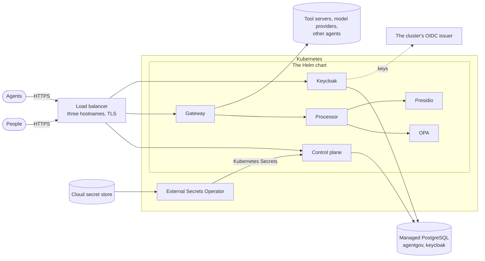

# Deploying AgentGov

| Where | Guide | For |
|---|---|---|
| Your machine | [Local](local.md): Docker Compose, Kubernetes with kind, or the control plane alone | Evaluation and development |
| Any Kubernetes cluster | [Kubernetes](kubernetes.md): the Helm chart | Your own clusters, on premises or in any cloud |
| Google Cloud | [GKE](gcp.md), with Cloud SQL and Secret Manager | Production on Google Cloud |
| Microsoft Azure | [AKS](azure.md), with Azure Database for PostgreSQL, Key Vault and Microsoft Entra ID | Production on Azure, and Microsoft 365 shops |
| Amazon Web Services | [EKS](aws.md), with RDS and Secrets Manager | Production on AWS |

[Requirements](../requirements.md) lists what each needs, and
[configuration](../configuration.md) every setting.

You don't have to run all of it. Without the gateway, AgentGov keeps an inventory of the
agents on your platforms, their findings and issues, with the control plane and PostgreSQL
alone; or the gateway can start out watching rather than stopping, without Presidio. The
chart has these as [profiles](kubernetes.md#profiles), and Compose as
[an inventory stack](local.md#just-the-inventory) and an
[override](local.md#optional-without-presidio).

## What a production deployment looks like

* The chart runs AgentGov's parts. The cloud provides the database, the secrets, the load
  balancer and the certificates, and the External Secrets Operator, installed beside the
  chart, copies the secrets into the cluster.
* Three HTTPS addresses: the control plane (people, the CLI, developers' tools), the
  gateway (agents) and Keycloak (sign-in, and agents' tokens).
* Secrets live in the cloud's secret store and reach the cluster as Kubernetes Secrets,
  which the chart reads by name.
* Agents in the same cluster can authenticate with their pods' service account tokens,
  which the cluster's OIDC issuer signs, instead of client secrets.

## Before others rely on it

- [ ] Every secret is long and random, in your secret store, and nowhere else: the tokens,
  the Keycloak client secrets, the database password ([configuration](../configuration.md)).
- [ ] HTTPS on all three addresses, and `urls` (or `AGENTGOV_PUBLIC_URL`) set to them.
- [ ] A managed PostgreSQL with backups and point-in-time recovery.
- [ ] Keycloak run for production (`keycloak.mode=production`, or your own), with your
  directory federated into it, and without the demo users and the demo app
  (`keycloak.demoUsers=false` before the first install: Keycloak imports the realm once,
  so on an existing installation, delete them in Keycloak).
- [ ] People sign in with single sign-on; automation uses role-scoped API keys; the
  bootstrap token is kept for break-glass access only.
- [ ] Network policies on, and policies of your own on tool servers, model endpoints and
  agents that serve A2A, letting in only the gateway.
- [ ] The controls at the gateway enforced. Monitor mode is for rolling a control out
  ([features](../features.md)).
- [ ] The ledger handed to your SIEM ([security operations](../secops.md)), its checkpoints
  time-stamped by an authority, and its retention chosen, with somewhere safe for the
  archives ([evidence](../evidence.md)).
- [ ] Two control-plane replicas or more, on PostgreSQL, so that one can go without
  anyone noticing; mutual TLS between the components and signed bundles left on
  ([production](../production.md)).
- [ ] A staging installation to try upgrades on first.

[SECURITY.md](../../SECURITY.md#deploying-safely) explains why each matters.

## Running it

* **Health.** The control plane answers `GET /healthz` (alive) and `GET /readyz` (ready,
  with its database), the gateway `GET /healthz`. The chart's probes use them.
* **Integrity.** `agentgov ledger verify` (or the overview's integrity badge) checks the
  evidence ledger's hash chain; the security team's SIEM gets the same entries as they
  are written.
* **Findings and statuses.** Problems AgentGov finds with itself are findings, such as an
  identity issuer Keycloak refused or a destination that keeps failing
  (`destination.failing`; `agentgov findings`). Each connection to Microsoft shows its own
  status, such as a permission that is missing (`agentgov platforms status`).
* **Upgrades.** Back up the database; the control plane migrates it when the new version
  starts ([Kubernetes](kubernetes.md#upgrading), [Compose](local.md#upgrading)).
