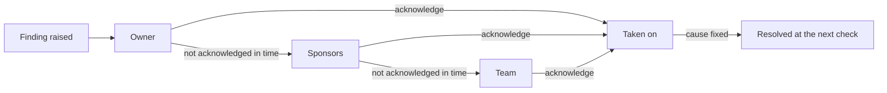

# Issues

AgentGov raises findings about agents: posture gaps from its scans, threats it detects at
runtime, and alerts from Microsoft Defender. Most of them only the people responsible for the
agent can fix. Its maker can add a sponsor, change its connections in Copilot Studio, or
retire it; an administrator of AgentGov often can't. So, with the **issues** feature (on by
default), each finding goes to those people, one step at a time:

1. the agent's **owner**,
2. then its **sponsors**,
3. then its **team**: the agent's own, its blueprint's, or the default team.

At each step AgentGov tells the people and teams there, by email and in the team's Teams or
Slack channel, and lists the issue for them in AgentGov. If none of them **acknowledges** it
in time, it goes on to the next step. Fixing the cause closes it at the next check. An
approver can also **accept the risk** until a date, with a reason.



Raising issues works where enforcing can't. Agents on other platforms only change when their
makers change them, or when an administrator with permissions in that platform does, and
AgentGov often has neither. The issue reaches the people who can fix it, and goes further
until someone takes it on. Where AgentGov can enforce, at its gateway, it still does: issues
add the people to the picture, they don't replace the controls in [features](features.md).
[Management rules](management-rules.md) use issues too: a rule that will block, delete or
change an agent tells its people first, with the date, and again once it has.

## Who it goes to

| A finding about | First | Then | Then |
|---|---|---|---|
| An agent | Its owner | Its sponsors | Its own team, else its blueprint's, else the default team |
| A tool server | Its owner | | The default team |
| Anything else, such as a failing destination or a policy bundle OPA can't load | | | The default team |

An owner or a sponsor is a person, by email address or user name, or a team, by name. A
person or team already reached at an earlier step isn't told again, and a step with nobody
new at it is left out. A finding with nobody at all to go to stays in AgentGov's list: give
the agent an owner, or mark a team as the default.

How each is reached:

* **People** by email, at their address (a user name has none), and in AgentGov, where they
  sign in to see **Your issues**.
* **Teams** at their email addresses (or, without any, their members'), in their Teams and
  Slack channels, and in AgentGov, where their members see the team's issues.

Emails need a mail server ([below](#messages)). Without one, issues reach people in AgentGov
and in their teams' chats only.

## Teams

A team is people and chat channels that own agents, and that issues escalate to. Add them
on **Findings** → **Teams**, with `agentgov teams create`, with `POST /v1/teams`, or as a
manifest:

```yaml
apiVersion: agentgov/v1alpha1
kind: Team
metadata:
  name: cx-platform
spec:
  description: Customer experience platform
  members: [alice@example.com, bob@example.com]
  emails: [cx-platform@example.com]
  destinations: [cx-teams]
  default: false
```

| Field | What it is |
|---|---|
| `members` | People in the team, by email address (as they sign in) or user name. They see the team's issues in AgentGov and may acknowledge them |
| `emails` | Where the team's issues are emailed: a list's or a shared mailbox's address, or people's own. Without any, its members' addresses |
| `destinations` | The Teams and Slack [destinations](secops.md#destinations) its issues are posted to. A destination a team posts to can't be deleted |
| `default` | Whether it takes the issues that have no team of their own. There is one default team: marking a team as the default unmarks the last one |

Blueprints name the team for their agents (`team`), and an agent can name its own instead
(`agentgov blueprints update support --team cx-platform`, or **Team** in the agent's and the
blueprint's forms). A team's name can't change, and a team can't be deleted while a
blueprint or an agent names it, as its team, owner or sponsor.

## How long each step waits

An issue waits at each step for the hours `AGENTGOV_ISSUE_ESCALATION_HOURS` gives its
severity: by default 4 for critical, 24 for high, 72 for medium, and a week for low and info.
At the last step it stays until someone acts. The control plane routes issues, escalates
them and sends what is due every `AGENTGOV_ISSUES_INTERVAL_SECONDS` (60).

## What people do with an issue

| Action | Who | What happens |
|---|---|---|
| Acknowledge | The people it reached so far (team members included), approvers and administrators, and the `secops` role from the triage level on | It goes no further up its chain. The people after them aren't told |
| Fix the cause | Whoever can | The next check (the posture scan, or the next sync of the system it came from) resolves it |
| Accept the risk | Approvers and administrators, and the `secops` role from triage on | It goes to nobody until the date chosen, at most a year away, and opens again then if it still holds. A reason is required |
| Resolve, dismiss | The same | As for any finding. Dismiss is for findings that are wrong: to live with a real one, accept its risk |
| Reopen | The same | It starts its chain over |

The people responsible for an agent acknowledge its issues, but don't accept its risks:
someone who isn't accountable for the agent signs that off.

Raised again after it was resolved, or when its accepted risk runs out, a finding starts its
chain over, from the first step.

| Where | How |
|---|---|
| Admin UI | **Findings**: who each issue is with, **Acknowledge** and **Accept risk**, the **Yours** filter, and a page per finding with its chain, its messages and its history. People without a role see **Your issues** |
| CLI | `agentgov findings list --mine`, `agentgov findings get ID`, `agentgov findings acknowledge ID`, `agentgov findings accept ID --reason "…" --until 2026-12-31` (or `--until 90`, in days) |
| API | `GET /v1/me/issues`, `GET /v1/findings/{id}`, `POST /v1/findings/{id}/acknowledge`, `POST /v1/findings/{id}/accept` with `{"reason": "…", "until": "2026-12-31"}` |

## People without an AgentGov role

Owners and sponsors are rarely administrators. While issues are on, people who sign in to
AgentGov through [single sign-on](administration.md) without an AgentGov role are let in,
and see only **Your issues**, and their approval requests when
[approvals-by-person](acting-for-people.md) is on. Everything else refuses them.

AgentGov knows them by the name they sign in with: their email address when the identity
provider has verified it, else their user name. Name owners and sponsors the same way, or
list the people as members of their teams. To keep people without a role out, restrict who
may sign in to AgentGov at the identity provider (in Microsoft Entra ID, require assignment
to its enterprise application), or turn issues off.

## Messages

Each email and chat message about an issue is tried until it goes: again five seconds after
it fails, then twice as long after each failure, up to ten minutes, and given up after about
an hour. Each one sent
is a `finding.notified` entry in the ledger, and each one given up on a
`finding.notification_failed` warning. The control-plane replica that leads sends them
([production](production.md#several-replicas)), and claims each message for a minute
before it sends it, so none goes twice while the lead moves. The finding's page lists its
messages and how each went.

An email's subject reads `[AgentGov] Medium issue about agent support-bot: …`. It says why
it came (as the agent's owner, one of its sponsors, or the team it escalates to) and links to
the issue in AgentGov. A chat gets a card with the same, and an **Acknowledge in AgentGov**
button.

Emails go through your mail server: `AGENTGOV_SMTP_URL` (`smtps://host:465`, or
`smtp://host:587` with STARTTLS, which AgentGov uses whenever the server offers it),
`AGENTGOV_SMTP_FROM`, and `AGENTGOV_SMTP_USERNAME` and `AGENTGOV_SMTP_PASSWORD` if it needs
them. A password is never sent to a server that doesn't offer TLS. In the Helm chart, set
them in `controlPlane.env`, with the password from a secret
([configuration](configuration.md#issues)).

## Checks that couldn't run

Some findings come from another system's data: the Copilot Studio inventory, Microsoft
Entra's agent identities, Defender's alerts. When the sync that reads it fails, AgentGov can't
tell whether its open findings still hold. They stay open, marked **unverified**, so that the
people they reached know they might not; the next sync that succeeds verifies them again.

A finding from Microsoft Entra closes only after two syncs in a row find its cause gone, so
one odd page of results from Microsoft Graph doesn't close it and open it again.

## In the ledger

| Entry | When |
|---|---|
| `finding.assigned` | It went to the first step of its chain |
| `finding.escalated` (warning) | Nobody acknowledged it in time: it went to the next step |
| `finding.acknowledged` | Someone took it on |
| `finding.accepted` (warning) | Its risk was accepted, with the date and the reason |
| `finding.reopened` | Raised again, reopened by hand, or its accepted risk ran out |
| `finding.notified` | A message went, to whom and how |
| `finding.notification_failed` (warning) | A message was given up on after retrying |
| `team.created`, `team.updated`, `team.deleted` | A team changed |

These go to the security team's tools like every ledger entry
([security operations](secops.md)): an issue is an OCSF Detection Finding whose status is New
until someone acknowledges it, then In Progress; an accepted risk is Suppressed.

## In the demo

The example manifests ([examples/manifests/teams.yaml](../examples/manifests/teams.yaml))
add two teams, each with its own channel at the demo sink: `cx-platform`, which owns the
support agents, and `ai-governance`, the default team. In step 18 of the demo,
`python examples/agents/demo_agent.py` shows the agent's issues in cx-platform's Slack
channel, the issues no team owns in ai-governance's Teams channel, and alice, a member of
cx-platform, acknowledging one. The sink's `/received?path=/slack/T0000/B0001/cx-platform`
lists what that channel got.

## Turning it off

`agentgov features set issues off`, or **Features** in the UI. Then nothing is routed or sent,
findings stay in AgentGov's list as before, and people without an AgentGov role can't sign in
unless approvals-by-person is on. Accepted risks still open again at their dates.
