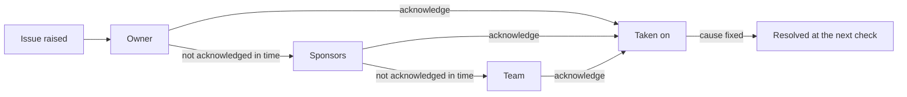

# Issues

AgentGov raises issues about agents: posture gaps from its scans, threats it detects at
runtime, and alerts from Microsoft Defender. Most of them only the people responsible for the
agent can fix. Its maker can add a sponsor, change its connections in Copilot Studio, or
retire it; an administrator of AgentGov often can't. So, with the **issues** feature (on by
default), each issue goes to those people, one step at a time:

1. the agent's **owner**,
2. then its **sponsors**,
3. then its **team**: the agent's own, its blueprint's, or the default team.

At each step AgentGov tells the people and teams there, by email and in the team's Teams or
Slack channel, and lists the issue for them in AgentGov. If none of them **acknowledges** it
in time, it goes on to the next step. Fixing the cause closes it at the next check. An
approver can also **accept the risk** until a date, with a reason.



Raising issues works where enforcing can't. Agents on other platforms only change when their
makers change them, or when an administrator with permissions in that platform does, and
AgentGov often has neither. The issue reaches the people who can fix it, and goes further
until someone takes it on. Blocking such an agent is one: while its platform still runs it,
an issue asks its people to stop it there ([platforms](platforms.md#blocked-in-agentgov-still-running)). Where AgentGov can enforce, at its gateway, it still does: issues
add the people to the picture, they don't replace the controls in [features](features.md).
[Management rules](management-rules.md) use issues too: a rule that will block, delete or
change an agent tells its people first, with the date, and again once it has.

## Who it goes to

| An issue about | First | Then | Then |
|---|---|---|---|
| An agent | Its owner | Its sponsors | Its own team, else its blueprint's, else the default team |
| A tool server | Its owner | | The default team |
| Anything else, such as a failing destination or a policy bundle OPA can't load | | | The default team |

An owner or a sponsor is a person, by email address or user name, or a team, by name. A
person or team already reached at an earlier step isn't told again, and a step with nobody
new at it is left out. An issue with nobody at all to go to stays in AgentGov's list: give
the agent an owner, or mark a team as the default.

How each is reached:

* **People** by email, at their address (a user name has none), and in AgentGov, where they
  sign in to see **Your issues**.
* **Teams** at their email addresses (or, without any, their members'), in their Teams and
  Slack channels, and in AgentGov, where their members see the team's issues.

Emails need a mail server ([below](#messages)). Without one, issues reach people in AgentGov
and in their teams' chats only.

## Teams

A team is people and chat channels that own agents, and that issues escalate to. Add them
on **Teams** (under *Settings*), with `agentgov teams create`, with `POST /v1/teams`, or as a
manifest:

```yaml
apiVersion: agentgov/v1alpha1
kind: Team
metadata:
  name: cx-platform
spec:
  description: Customer experience platform
  members: [alice@example.com, bob@example.com]
  emails: [cx-platform@example.com]
  destinations: [cx-teams]
  default: false
```

| Field | What it is |
|---|---|
| `members` | People in the team, by email address (as they sign in) or user name. They see the team's issues in AgentGov and may acknowledge them |
| `emails` | Where the team's issues are emailed: a list's or a shared mailbox's address, or people's own. Without any, its members' addresses |
| `destinations` | The Teams and Slack [destinations](secops.md#destinations) its issues are posted to. A destination a team posts to can't be deleted |
| `default` | Whether it takes the issues that have no team of their own. There is one default team: marking a team as the default unmarks the last one |

Blueprints name the team for their agents (`team`), and an agent can name its own instead
(`agentgov blueprints update support --team cx-platform`, or **Team** in the agent's and the
blueprint's forms). A team's name can't change, and a team can't be deleted while a
blueprint or an agent names it, as its team, owner or sponsor, or while a control's
[exceptions](features.md#exceptions) or a [management rule](management-rules.md#which-agents)
do.

## How long each step waits

An issue waits at each step for the hours `AGENTGOV_ISSUE_ESCALATION_HOURS` gives its
severity: by default 4 for critical, 24 for high, 72 for medium, and a week for low and info.
At the last step it stays until someone acts. The control plane routes issues, escalates
them and sends what is due every `AGENTGOV_ISSUES_INTERVAL_SECONDS` (60).

## What people do with an issue

| Action | Who | What happens |
|---|---|---|
| Acknowledge | The people it reached so far (team members included), approvers and administrators, and the `secops` role from the triage level on | It goes no further up its chain. The people after them aren't told |
| Fix the cause | Whoever can | The next check (the posture scan, or the next sync of the system it came from) resolves it |
| Say it isn't yours, and why | The people it reached | It goes on to the next step of its chain at once (see [Answering an issue](#answering-an-issue)) |
| Ask to accept the risk | The people it reached | An approver decides whether to accept its risk until the date asked for |
| Say you fixed it | The people it reached, approvers and administrators | AgentGov checks it again now, where it can, and resolves it if it is gone |
| Accept the risk | Approvers and administrators, and the `secops` role from triage on | It goes to nobody until the date chosen, at most a year away, and opens again then if it still holds. A reason is required |
| Resolve, dismiss | The same | As for any issue. Dismiss is for issues that are wrong, and says why ([dismissing an issue](#dismissing-an-issue)): to live with a real one, accept its risk |
| Reopen | The same | It starts its chain over |

The people responsible for an agent acknowledge its issues, but don't accept its risks:
someone who isn't accountable for the agent signs that off. AgentGov refuses an acceptance
from the agent's owner, its sponsors and the people in its team (its own or its
blueprint's), whatever their role.

Raised again after it was resolved, or when its accepted risk runs out, an issue starts its
chain over, from the first step.

| Where | How |
|---|---|
| Admin UI | **Issues**: who each issue is with, **Acknowledge** and **Accept risk**, the **Yours** and **Risk acceptance asked** filters, and a page per issue with its chain, its messages and its history, where the people it reached also say **Not mine**, **Ask to accept the risk** or **I fixed it**. People without a role see **Your issues** |
| CLI | `agentgov issues list --mine`, `agentgov issues get ID`, `agentgov issues acknowledge ID`, `agentgov issues accept ID --reason "…" --until 2026-12-31` (or `--until 90`, in days), `agentgov issues not-mine ID --reason "…"`, `agentgov issues ask-to-accept ID --reason "…" --until 90`, `agentgov issues decline-to-accept ID --reason "…"`, `agentgov issues recheck ID` |
| API | `GET /v1/me/issues`, `GET /v1/findings/{id}`, `POST /v1/findings/{id}/acknowledge`, `POST /v1/findings/{id}/accept` with `{"reason": "…", "until": "2026-12-31"}`, `POST /v1/findings/{id}/not-mine` with `{"reason": "…"}`, `POST /v1/findings/{id}/exception` with `{"reason": "…", "until": 90}`, `POST /v1/findings/{id}/exception/decline`, `POST /v1/findings/{id}/recheck`, and `GET /v1/findings?asked=true` for those whose people asked for their risk to be accepted. The API calls issues findings |

### Answering an issue

The people an issue reaches aren't always the right ones, and can't always fix it at once.
On its page (the link in each email and chat message), besides acknowledging it, they can:

* **Say it isn't theirs.** They say why, for instance whose it is. It goes on to the next
  step of its chain at once, rather than when its time runs out, and the people there see
  why in its history. At the last step it stays there. Someone it reached at an earlier step
  can say so too: it is recorded, and the issue stays where it is.
* **Ask to accept the risk.** They say why its risk is acceptable for now, and until when
  (a year at most). The issue stays with them, acknowledged, and is listed under **Risk
  acceptance asked**, and on **Approvals**, for approvers, who accept its risk (with what was asked, or changed) or decline,
  saying why; declined, it stays with whoever asked, to fix. The people accountable for the
  agent can't accept its risks themselves.
* **Say they fixed it.** AgentGov checks it again at once where it can: with a posture
  scan, by reading the agent's platform again (one clean read is enough when someone asks,
  where a scheduled sync takes two), with its Microsoft connection, by computing the agent's
  risk again, or by checking its instructions again. If it is gone, it is resolved;
  otherwise it stays open and says so. A Copilot Studio agent's issues come from the last
  import or sync, so a fix made in Copilot Studio shows after the next one. Threats and
  issues from other systems can't be checked on demand: they resolve themselves, or an
  approver resolves them.

## People who leave

People leave, and their agents stay. Once AgentGov can tell, it stops sending an issue to
someone who has left, and says whose agents need someone else:

* **Who it can tell about.** The owners and sponsors it names by email address (and the
  makers platforms name: [who made each agent](platforms.md#who-made-each-agent)), looked
  up in Microsoft Entra ID with the `entra-users` connection, as an admin signed in with
  Microsoft who syncs Copilot Studio, or from an uploaded list of users. Someone it looked up
  is read again a week later. Owners named by a user name, and teams, it can't look up:
  keep team membership current instead.
* **Who has left.** Someone the directory had and no longer has (a `person.left` entry in
  the ledger), or whose account is disabled: User.Read.All, or an uploaded list with
  `accountEnabled`, says so; User.ReadBasic.All doesn't.
* **What happens.** An issue's chain passes over them: an agent's issues go to its sponsors
  and team when its owner has left. The posture scan raises `agent.owner_left` (medium) and
  `agent.sponsor_left` (medium when no sponsor is left, low otherwise) on their agents, and
  the agent's page says who has left. Naming someone else resolves them at the next scan.

## People without an AgentGov role

Owners and sponsors are rarely administrators. While issues are on, people who sign in to
AgentGov through [single sign-on](administration.md) without an AgentGov role are let in,
and see only **Your issues**, and their approval requests when
[approvals-by-person](acting-for-people.md) is on. Everything else refuses them.

AgentGov knows them by the name they sign in with: their email address when the identity
provider has verified it, else their user name. Name owners and sponsors the same way, or
list the people as members of their teams. To keep other people out, restrict who may sign
in to AgentGov at the identity provider (in Microsoft Entra ID, require assignment to its
enterprise application), or set `AGENTGOV_OIDC_REQUIRE_ROLE` and give owners and sponsors
the `person` role ([who can sign in](administration.md#who-can-sign-in)).

## Messages

Each email and chat message about an issue is tried until it goes: again five seconds after
it fails, then twice as long after each failure, up to ten minutes, and given up after about
an hour. An email that can't be written at all is given up on at once, and the others still
go. Each one sent
is a `finding.notified` entry in the ledger, and each one given up on a
`finding.notification_failed` warning. The control-plane replica that leads sends them
([production](production.md#several-replicas)), and claims each message for a minute
before it sends it, so none goes twice while the lead moves. The issue's page lists its
messages and how each went.

An email's subject reads `[AgentGov] Medium issue about agent support-bot: …`, on one line:
line breaks and other control characters in an issue's title, which can carry names agents,
platforms and developers give, are spaces there. It says why
it came (as the agent's owner, one of its sponsors, or the team it escalates to), what its
people can do there, and links to the issue in AgentGov. A chat gets a card with the same,
and an **Answer in AgentGov** button.

Emails go through your mail server: `AGENTGOV_SMTP_URL` (`smtps://host:465`, or
`smtp://host:587` with STARTTLS, which AgentGov uses whenever the server offers it),
`AGENTGOV_SMTP_FROM`, and `AGENTGOV_SMTP_USERNAME` and `AGENTGOV_SMTP_PASSWORD` if it needs
them. A password is never sent to a server that doesn't offer TLS. In the Helm chart, set
them in `controlPlane.env`, with the password from a secret
([configuration](configuration.md#issues)).

Where work runs through a service desk, each issue can also be a ticket there, which
AgentGov keeps in step with it: someone taking the ticket on there takes the issue on
([tickets in service desks](tickets.md)).

### Fewer messages

Not every issue needs to reach an inbox:

* **A severity floor.** `AGENTGOV_ISSUES_NOTIFY_SEVERITY` (`medium` by default; `info`
  sends every issue) sends emails and chat messages for issues of that severity and above
  only. Those below still go to their people, one step at a time, and are listed for them
  in AgentGov; their `finding.assigned` and `finding.escalated` entries say why nothing was
  sent (`quiet`).
* **A quiet first sync.** When AgentGov first reads a platform (AWS, Copilot Studio,
  Microsoft 365, ...), what it finds about the platform's agents was there before anyone
  looked: their risky settings, and AgentGov's own issues about them. With
  `AGENTGOV_ISSUES_QUIET_FIRST_SYNC` (true by default), those go to their people in
  AgentGov without an email or a chat message, so that connecting a platform doesn't flood
  inboxes; the issue's `details.baseline` says so. One message does go: the issue that
  says how many of the platform's agents are left to review (`platform.agents_to_review`),
  to the catch-all team. What later syncs find is sent as usual, and so is a baseline
  issue that comes back after it was resolved.
* **Types turned off** reach no one at all ([below](#kinds-of-issues)).

### A daily digest

What can't wait comes one message at a time; the rest can come together, once a day. With
`AGENTGOV_ISSUES_DIGEST_AT` set (`08:30`, say, in `AGENTGOV_ISSUES_DIGEST_TIMEZONE`, such as
`Europe/London`, on the days in `AGENTGOV_ISSUES_DIGEST_DAYS`: Monday to Friday by
default), each address and team chat with open issues gets one message a day that lists
them. Those waiting for someone to take them on come first, then those taken on and not
fixed yet, the most severe first. Each has a link to it, says when it goes further unless
someone takes it on, and is marked new if it was found since the last digest. An email lists
25 and counts the rest; a chat message lists 10, and links to the issues in AgentGov.

Issues below `AGENTGOV_ISSUES_NOTIFY_SEVERITY` are in it too. So with
`AGENTGOV_ISSUES_NOTIFY_SEVERITY=high` and a digest, critical and high issues are sent as
they come, and everything else once a day.

The digest goes where an issue's messages go: to the people at the step of its chain it is
at. An issue that went on to its sponsors is in their digest, not its owner's. Each digest
sent is an `issues.digest_sent` entry in the ledger, with how many issues it listed. One
that can't be sent is tried again a little later, waiting longer each time; after six tries
it is an `issues.digest_failed` warning, and waits for the next day's. With several
replicas, the one that leads sends it, once.

## Kinds of issues

Every check raises issues of its own types, such as `agent.no_owner`,
`platform.no_guardrail` or `agent.ungranted_tool_use`, at the severity it judges. An
organisation that doesn't act on some of them, or judges them otherwise, says so per type:

* **Off.** The check still runs, but what it finds is kept dismissed: in nobody's list and
  no one's inbox. Its open issues are dismissed when it is turned off (each a
  `finding.dismissed` entry, by the administrator, "its type is off"). Turned on again, what
  its checks find again comes back, the next time they run; an issue someone dismissed by
  hand stays dismissed.
* **A severity of its own.** For what the type finds from then on, and what it found that is
  still open; `default` (null) goes back to its checks' own.

```console
$ agentgov issues type platform.shared_with_everyone --severity low
finding-type/platform.shared_with_everyone: on, severity low
$ agentgov issues type agent.no_sponsor --off
$ agentgov issues types
TYPE                           MODE  SEVERITY       OPEN  TOTAL
agent.no_owner                 on    (its checks')  3     5
agent.no_sponsor               off   (its checks')  0     0
platform.shared_with_everyone  on    low            12    12
```

In the UI, **Issues > Types** lists every type AgentGov has raised, with how many are
open, and an administrator changes one there, or sets up a type before anything of it is
raised. The API is `GET /v1/finding-types` and `PUT /v1/finding-types/{type}` with
`{"mode": "off"}` or `{"severity": "low"}`, and manifests have a `FindingType` kind:

```yaml
apiVersion: agentgov/v1alpha1
kind: FindingType
metadata: {name: platform.shared_with_everyone}
spec: {severity: low}
```

Each change is a `finding_type.changed` entry in the ledger, a warning when it turns a type
off or lowers its severity.

## Checks that couldn't run

Some issues come from another system's data: the Copilot Studio inventory, Microsoft
Entra's agent identities, Defender's alerts, the other platforms AgentGov reads. When the
sync that reads it fails, or reads some of it only (a region it may not read, an agent whose
resource policy it can't see, more pages than it reads), AgentGov can't tell whether the
open issues it would have checked still hold. They stay open, marked **unverified**, with
why: "the last AWS sync couldn't read 111122223333/us-west-2: AccessDeniedException ...".
The people they reached know they might not hold; the next sync that reads them verifies
them again.

An issue from another platform closes only after two syncs in a row find its cause gone, so
one odd page of results doesn't close it and open it again.

## Threats that don't happen again

A threat is an event: an agent used a tool it isn't granted, or called another agent around
the gateway. One that hasn't happened again for `AGENTGOV_THREAT_FINDING_DAYS` (30) is
resolved, with a `finding.resolved` entry that says so; if it happens again, it opens again
and starts its chain over. `0` keeps threats open until someone closes them. Posture
issues aren't affected: they close when their check finds their cause gone.

## Dismissing an issue

Dismissing says an issue is wrong, and why: the reason is in the ledger and on the
issue. It can be for a while (`until`: a date, or a number of days, a year at most), after
which it opens again if it still holds and someone decides anew; without one, it is for
good. A threat someone dismissed opens again as soon as it happens again, its history saying
who dismissed it and why: each one is a new event.

| Where | How |
|---|---|
| Admin UI | An issue's **Dismiss** asks why, and until when |
| CLI | `agentgov issues dismiss ID --reason "…" [--until 30]` |
| API | `POST /v1/findings/{id}/dismiss` with `{"reason": "…", "until": 30}` |

## When it gets worse

An issue raised again at a higher severity than its people were told it had (medium,
then high) starts its chain over, from its first step: they are told again, and a step that
had acknowledged it acknowledges it again (`finding.severity_raised`). Its severity
settling back, or rising again only as far as they were told, tells nobody again.

## Many at once

On **Issues**, tick issues, or all of those shown, or, with **Group by agent**, all of
those about an agent, and act on them together: **Acknowledge**, **Resolve**, **Accept
risk…** and **Dismiss…** (one reason, and one date, for all of them) and **Reopen**. Each is
done on its own: one that can't be is left as it was, and AgentGov lists those left, with
why. Accepting the risk of one about an agent you sponsor is left, for instance: someone
else signs that off. The people an issue reached acknowledge theirs this way too; approvers,
administrators and the `secops` role (from triage on) do the rest. **Download CSV** gives
the issues shown as a spreadsheet: who each is with, how often it was seen, who closed it.

| Where | How |
|---|---|
| Admin UI | **Issues**: the boxes on issues and on agents' groups, the bar above them, **Group by agent**, **Download CSV** |
| CLI | Name several: `agentgov issues dismiss ID ID --reason "A red-team exercise"`, and the same for `acknowledge`, `resolve`, `accept` and `reopen`. `agentgov issues list -q` prints only IDs, `--csv` every column |
| API | `POST /v1/findings/bulk` with `{"action": "dismiss", "findings": [...], "reason": "…", "until": 30}`: up to 500 a call. It answers with those `done`, and those `left`, each with `why` |

## In the ledger

| Entry | When |
|---|---|
| `finding.assigned` | It went to the first step of its chain |
| `finding.escalated` (warning) | Nobody acknowledged it in time: it went to the next step |
| `finding.acknowledged` | Someone took it on |
| `finding.declined` | Someone it reached said it isn't theirs, and why |
| `finding.exception_requested`, `finding.exception_declined` | Someone asked for its risk to be accepted; an approver declined |
| `finding.fix_claimed` | Someone said they fixed it: how AgentGov checked it, and whether it was gone |
| `person.left` (warning) | Someone the directory had is no longer there ([people who leave](#people-who-leave)) |
| `finding.accepted` (warning) | Its risk was accepted, with the date and the reason |
| `finding.reopened` | Raised again, reopened by hand, its accepted risk or dismissal ran out, or a dismissed threat happened again |
| `finding.severity_raised` | Raised again more severe than its people were told: they are told again |
| `finding.resolved` | Its cause is gone, or, a threat, it hasn't happened for a while |
| `finding.dismissed` | Dismissed by hand, with why (and until when), or because its type was turned off |
| `finding_type.changed` | A type was turned off or on, or given a severity |
| `finding.notified` | A message went, to whom and how |
| `finding.notification_failed` (warning) | A message was given up on after retrying, or at once if it couldn't be written |
| `issues.digest_sent` | The day's digest went to an address or a chat, with how many issues it listed ([a daily digest](#a-daily-digest)) |
| `issues.digest_failed` (warning) | The day's digest couldn't be sent, after retrying |
| `team.created`, `team.updated`, `team.deleted` | A team changed |
| `finding.ticket_opened`, `finding.ticket_done`, `finding.ticket_closed`, `finding.ticket_failed` | Its ticket in a service desk opened, was resolved there, was resolved by AgentGov, or couldn't be opened ([tickets](tickets.md#in-the-ledger)) |

These go to the security team's tools like every ledger entry
([security operations](secops.md)): an issue is an OCSF Detection Finding whose status is New
until someone acknowledges it, then In Progress; an accepted risk is Suppressed.

## In the demo

The example manifests ([examples/manifests/teams.yaml](../examples/manifests/teams.yaml))
add two teams, each with its own channel at the demo sink: `cx-platform`, which owns the
support agents, and `ai-governance`, the default team. In step 18 of the demo,
`python examples/agents/demo_agent.py` shows the agent's issues in cx-platform's Slack
channel, the issues no team owns in ai-governance's Teams channel, and alice, a member of
cx-platform, acknowledging one. The sink's `/received?path=/slack/T0000/B0001/cx-platform`
lists what that channel got.

## Turning it off

`agentgov features set issues off`, or **Features** in the UI. Then nothing is routed or sent,
issues stay in AgentGov's list as before, and people without an AgentGov role can't sign in
unless approvals-by-person is on. Accepted risks still open again at their dates.
