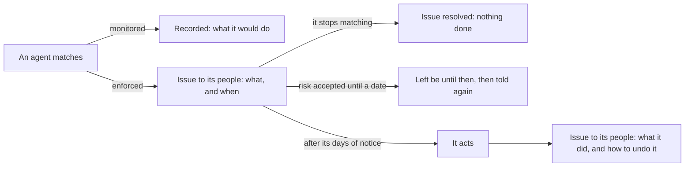

# Management rules

Agents pile up. Some nobody uses any more, some lose their owner when people move on, some
registrations wait for an approval that never comes. A **management rule** says what to do
about the agents that meet some conditions for long enough: raise an issue, give them an
owner, block them, delete them, or revoke their access packages.

Rules tell before they act. As soon as an agent matches an enforced rule that changes
something, its people (its owner, then its sponsors, then its team) get an
[issue](issues.md) saying what the rule will do and when. The rule acts only after its days
of notice, and only if the agent still matches. Until then, they can make the agent stop
matching, or an approver can accept the risk until a date. A monitored rule tells nobody
and changes nothing: it records what it would have done.



Microsoft Agent 365's agent management rules (in preview) block ownerless agents without
usage, or reassign them, after administrators review the agents a rule affects
([baseline](baseline-agent365.md)). AgentGov's rules also tell each agent's people first,
can be monitored before they are enforced, and act on a few agents at once at most.

## A rule

```yaml
apiVersion: agentgov/v1alpha1
kind: ManagementRule
metadata:
  name: inactive-agents
spec:
  description: Block agents nobody has used for 90 days
  conditions:
    inactive_days: 90
  scope:
    platforms: [gateway]
  action: block
  after_days: 14
  mode: enforce
```

| Field | What it is |
|---|---|
| `conditions` | What an agent must meet, all of it ([conditions](#conditions)) |
| `scope` | Which agents the rule looks at: all of them, unless it says ([scope](#which-agents)) |
| `action` | `issue`, `assign_owner`, `block`, `delete` or `revoke_access` ([actions](#actions)) |
| `params` | What the action needs: `owner`, the team or email address `assign_owner` makes the owner |
| `after_days` | How many days an agent matches before the action: the days of notice its people get (14 by default; at least 1 for rules that change something; 0 raises issues at once) |
| `severity` | Its issues' severity, which decides how soon they escalate: `low`, `medium` (the default), `high` or `critical` |
| `max_actions` | How many agents it acts on at once, at most (10 by default) |
| `mode` | `monitor` (the default), `enforce` or `off`; the feature's mode caps it ([monitor first](#monitor-first)) |
| `description`, `labels` | What it is for, and labels of your own |

A rule's name can't change: the ledger names it.

## Conditions

| Condition | An agent meets it when |
|---|---|
| `inactive_days: N` | Nothing was seen of it for N days: no call through the gateway, and no use on another platform AgentGov reads |
| `missing: [...]` | It has no `owner`, no `sponsors`, no `team` (its own or its blueprint's), no `blueprint`, or no `workload_identity`: any of those listed |
| `attestation_overdue_days: N` | Its attestation expired N days ago or more |
| `findings: [...]` | It has an open issue of one of these types, `*` wildcards allowed (such as `agent.stale` or `defender.*`); with `finding_severity`, one at least that severe |
| `risk_level` | Its risk is at least `low`, `medium`, `high` or `critical` |
| `status: [...]` | It is `pending`, `active`, `blocked` or `discovered` (unmanaged) |

A rule doesn't guess. Agents on Microsoft 365 and Copilot Studio are inactive only by what
AgentGov reads of their use from the [Purview audit log](microsoft-connections.md), and
only since it started reading it: while it doesn't, or its last read is more than two days
old, a rule can't tell, and the agent doesn't match. Previews list those agents apart. A
blueprint and a workload identity are never missing for them: their platform governs that.

Issues count while they are open: one whose risk was accepted, one dismissed, and one a
failed sync can't vouch for (unverified) don't. Rules' own issues never count.

## Which agents

`scope` narrows the agents a rule looks at; each key given must hold.

| Key | Agents |
|---|---|
| `blueprints` | On one of these blueprints |
| `teams` | Of one of these teams (the agent's own, or its blueprint's) |
| `environments` | In one of these environments |
| `platforms` | Where they run: `gateway`, or a platform AgentGov reads (`microsoft-365`, `copilot-studio`, `entra-agent-id`, `aws`, `google-cloud`, `salesforce`, `databricks`, `microsoft-foundry`) |
| `labels` | With all these labels |

A scope names teams and blueprints that are there: a misspelt one, which would match no
agent, is refused. A team or blueprint a rule names, in its scope or as the owner it gives
agents, can't be deleted while the rule does. A role for one team can't edit its agents out
of a rule's scope (with another environment or label, say): administrators for every team
do that ([roles for one team](administration.md#roles-for-one-team)). Where an agent runs is
AgentGov's to say, not its registration's: one registered through the API or a manifest
runs at the `gateway`.

An agent labelled `agentgov/exempt-rules` is left out of the rules it names (`inactive-agents,
stale-registrations`), or of all of them (`*`); only administrators set labels under
`agentgov/`. Each action also looks only at the agents
it can do something to: a rule that blocks, at pending, active and unmanaged agents; one
that deletes, at any agent not deleted yet; one that revokes access, at agents that hold
access packages; and one that gives an owner, at agents without one.

## Actions

| Action | What it does | What people can do about it |
|---|---|---|
| `issue` | Raises an issue about the agent, once it has matched for `after_days`; that is all | Act on it; resolved, it stays resolved while the agent still matches |
| `assign_owner` | Makes `params.owner` the agent's owner | Give it the right owner |
| `block` | Blocks the agent at the gateway, as the kill switch does | Unblock it |
| `delete` | Deletes the agent, which can be restored until it is purged (`AGENTGOV_SOFT_DELETE_RETENTION_DAYS`, 30) | Restore it before then |
| `revoke_access` | Revokes the [access packages](access-packages.md) the agent holds | Ask for them again |

AgentGov can't block or delete agents that run on other platforms: the gateway never sees
their calls. For them, a rule's issue says so, and says to do it in that platform's admin
center. The exception is blocking a Copilot Studio agent while [Copilot Studio threat
detection](microsoft-connections.md#copilot-studio-threat-detection) is enforced: Copilot
Studio then asks AgentGov before each tool call, so a rule blocks the agent and its tool
calls stop. It still answers people, so an issue then asks its people to quarantine it
([Blocked in AgentGov, still running](platforms.md#blocked-in-agentgov-still-running)).
Otherwise the rule's issue says to quarantine the agent.

## Telling first, and what stops a rule

* **The notice.** An enforced rule that changes something raises its issue (`rule.matched`)
  as soon as an agent matches, and the issue goes to the agent's owner, then its sponsors,
  then its team, by email and in their chats ([issues](issues.md)). It says what the rule
  will do and on which day: `after_days` after the issue was raised.
* **It stops matching.** The agent was used, got an owner, was attested: the rule forgets
  it, and its issue is resolved. Should it match again later, the notice starts over.
* **Risk accepted.** An approver accepts the risk until a date: the rule leaves the agent be
  until then, and gives a new full notice once the date has passed.
* **Dismissed, or exempt.** A dismissed issue keeps the rule off the agent while it matches;
  the `agentgov/exempt-rules` label keeps it off for good.
* **When it acts**, its issue goes to the agent's people again, saying what it did and how to
  undo it. It stays open while the agent stays blocked or deleted.
* **People decide.** Once a rule acted on an agent, it leaves the agent be for as long as it
  still matches, even if someone undid what it did: an agent someone unblocked isn't
  blocked again the next minute.
* **A few at once.** When more agents are due at once than the rule's `max_actions`, it acts
  on none of them, says so in each of their issues, and raises an issue about itself
  (`rule.too_many`) for the default team: check what it matches before raising its limit.
  A rule that matches far more than its author meant can't block every agent.

## Monitor first

How far rules go is the **management-rules** feature ([features](features.md)), and each
rule's own `mode`; the weaker of the two applies.

| Mode | What rules do |
|---|---|
| `enforce` | Rules in enforce mode tell, then act |
| `monitor` (default) | Rules tell nobody and change nothing: each records, once per agent, what it would have done (`rule.would_act` in the ledger) |
| `off` | No rule runs, and their issues are resolved. What they did stays done |

Add a rule monitored, preview it, and enforce it once it matches what you meant. A preview
lists the agents it matches now, since when, and what it will do to each, and when: in the
admin UI, **Preview** on the rule (or in its form, before saving it); with the CLI,
`agentgov rules preview NAME` (or `agentgov rules create … --dry-run`); with the API,
`GET /v1/rules/{name}/preview` (or `POST /v1/rules/preview` with a rule that isn't saved).

## When rules run

After each posture scan (`AGENTGOV_POSTURE_INTERVAL_SECONDS`, 300), and when an
administrator runs them: **Run now** on **Policies**, `agentgov rules evaluate`, or
`POST /v1/rules/evaluate`. They don't run while posture checks are off: rules act on what
the checks find.

## Where

| Where | How |
|---|---|
| Admin UI | **Policies** → **Management rules**: add, edit, preview, delete, run now; an agent's page lists the rules it matches |
| CLI | `agentgov rules list`, `get`, `create NAME --inactive-days 90 --action block --after-days 14 [--dry-run]`, `update`, `delete`, `preview NAME`, `evaluate`, `agent AGENT` |
| API | `GET`/`POST /v1/rules`, `GET`/`PATCH`/`DELETE /v1/rules/{name}`, `GET /v1/rules/{name}/preview`, `POST /v1/rules/preview`, `POST /v1/rules/evaluate`, `GET /v1/agents/{ref}/rules` |
| Manifests | `kind: ManagementRule`, applied after teams and before agents |

Administrators add, change and run rules; everyone who reads AgentGov sees and previews
them; an agent's owner and sponsors see the rules that match their agent.

## Examples

[examples/manifests/rules.yaml](../examples/manifests/rules.yaml) has five rules, all
monitored:

* `inactive-agents` blocks agents nobody has used for 90 days, two weeks after telling
  their people.
* `ownerless-agents` blocks active agents left without an owner, two weeks after telling
  their sponsors and team (Agent 365's example rule blocks ownerless agents too). To give
  them to a team instead, change its action to `assign_owner` with `params: {owner: TEAM}`.
* `stale-registrations` deletes registrations nobody approved within 30 days.
* `unapproved-connectors` blocks agents that still use a connector that isn't on the
  [connector allowlist](platforms.md#when-an-agent-uses-a-connector-that-isnt-approved) a
  week after their people were told: for Copilot Studio agents, while threat detection is
  enforced.
* `expired-access` revokes access packages a week after they expired, unless renewed.

In step 19 of the demo, `python examples/agents/demo_agent.py`, an administrator previews
a rule that deletes agents blocked for 30 days, which matches the demo agent (blocked in
step 13). Enforced, it raises its issue at once, for the agent's owner, cx-platform, and
its sponsor, alice. alice can't accept its risk, being accountable for the agent; an
administrator accepts it until a date, and the rule leaves the agent be.

## In the ledger

| Entry | When |
|---|---|
| `rule.created`, `.updated`, `.deleted` | A rule changed |
| `finding.raised` (`rule.matched`) | An enforced rule told an agent's people what it will do |
| `finding.acted` (warning) | It did it: with `agent.block`, `agent.delete`, `agent.updated` or `access.revoked` |
| `rule.would_act` | A monitored rule would have acted |
| `rule.held_back` (warning) | More agents were due at once than its `max_actions` |

What a rule does is recorded with the actor `system:rule:<name>`, and the reason names the
rule and why the agent matched.
