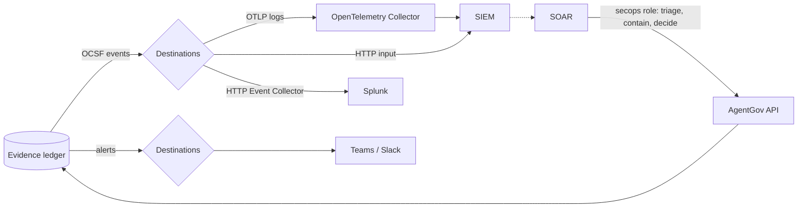

# Security operations

AgentGov records everything it decides in the [evidence ledger](architecture.md) and raises
issues about agents. The security team works elsewhere: in a SIEM, a SOAR and a chat
channel. The **security-operations** feature hands AgentGov's evidence and alerts to their
tools, at the level you choose:

* their **SIEMs** get the ledger as [OCSF](https://schema.ocsf.io) events (version 1.9.0),
  the open schema SIEMs and security data lakes read, through OpenTelemetry, an HTTP input or
  Splunk's HTTP Event Collector;
* their **Teams and Slack** channels get alerts: issues from a severity up, approval
  requests and kill switches;
* their **tools and analysts**, with the `secops` role, may do as much in AgentGov as the
  level allows, and no more.



## How much is handed over

The feature's mode is the level. Each level includes the ones before it.

| Level | Sent | What the `secops` role may do |
|---|---|---|
| **off** (default) | Nothing | Read everything, like `auditor` |
| `inform` | SIEMs and chats get what their destinations take; the [events API](#the-events-api) answers | Read |
| `triage` | The same | Also acknowledge, resolve, dismiss and reopen [issues](issues.md) and accept their risks |
| `contain` | The same | Also block and unblock agents, tool servers, model providers and identity issuers |
| `decide` | The same | Also approve and deny the approval requests sent to approvers |

Choose it like any [feature](features.md): **Security operations** (or **Features**) in
the UI, `agentgov secops level contain`, `PUT /v1/features/security-operations` with
`{"mode": "contain"}`, a `Feature` manifest, or pinned by the deployment with
`AGENTGOV_FEATURES=security-operations=inform`. Only administrators choose it, and each
change is a `feature.changed` entry in the ledger.

Administrators and approvers do what their roles allow whatever the level: the level only
limits the `secops` role, held for every team or for one team's agents (`secops@sales`,
[roles for one team](administration.md#roles-for-one-team)) alike. Some things it never does
at any level: delete or edit anything, change policies, blueprints or grants, approve
agents or tool servers, or decide requests sent to the person an agent acted for. Unblocking
approves nothing either: an agent or a tool server is then what it was when it was blocked,
and one that waited for an administrator's approval waits again. Everything it does is in
the ledger under its name, `secops:<key or person>`, and an administrator can undo all of
it (unblock, reopen).

## The secops role

Give the security team's tools an **API key** with the `secops` role (**Access** →
**Create API key**, or `agentgov apikeys create soar --role secops`), and their analysts
the **`agentgov-secops`** role in the identity provider for single sign-on (the demo realm's
`sofia` has it). The role reads everything, as auditors do; what it may change follows the
level above. `GET /v1/me` tells a client its level (`handoff.level`), and the UI shows a
`secops` user the buttons the level allows.

## Destinations

A destination is where AgentGov sends: a SIEM, which gets OCSF events, or a chat, which
gets alerts. A service desk (`servicenow`, `jira` or `freshservice`) is a destination too,
which gets [issues](issues.md) as tickets it keeps in step with them, whatever the hand-off
level: [tickets in service desks](tickets.md).

| Kind | Gets | `url` | Its secret file holds |
|---|---|---|---|
| `otlp` | OCSF events as OpenTelemetry logs (OTLP/HTTP, JSON), one log record per event, at `<url>/v1/logs` | An OpenTelemetry Collector's OTLP/HTTP endpoint (port 4318), or any backend that takes OTLP | Optional: HTTP headers, one per line (`Authorization: Bearer …`) |
| `webhook` | OCSF events as a JSON array per request (`format: json`), or one per line (`format: ndjson`) | The SIEM's or pipeline's HTTP input | Optional: HTTP headers, one per line; and the URL, on a line of its own, when the URL is the credential (as with Sumo Logic). Without `url`, required |
| `splunk-hec` | OCSF events for Splunk's HTTP Event Collector (`sourcetype` `ocsf:agentgov`), at `<url>/services/collector/event` | Splunk's HEC endpoint, such as `https://splunk.example.com:8088` | The HEC token (required) |
| `slack` | Alerts, as Block Kit messages | — | The incoming webhook's URL (required) |
| `teams` | Alerts, as Adaptive Cards | — | The URL of a Teams workflow that posts to the channel (required) |

An OpenTelemetry Collector reaches most SIEMs, with its exporters for them; most of the
rest have an HTTP input (`webhook`). OCSF is the schema Amazon Security Lake stores, and
many SIEMs map it.

**What a SIEM gets** (`events`), all of it by default:

| `events` | Ledger entries |
|---|---|
| `decisions` | Tool calls, model calls and calls between agents the gateway decided, Copilot Studio's tool calls, and tools agents used without the gateway (telemetry) |
| `approvals` | Approval requests, decisions, use and cancellations |
| `findings` | Issues raised, reopened, resolved and dismissed |
| `access` | Sign-ins, sign-outs and API keys |
| `changes` | Everything else: what AgentGov governs, who changed it, and what was detected about agents and tool servers |

`min_severity` (`info`, `low`, `medium`, `high`, `critical`) leaves out events below it:
`medium` keeps the denials, the warnings and the issues that matter.

**What a chat gets** (`events`): `findings` (raised or reopened, from `min_severity` up,
which is `high` for chats by default), `approvals` (requests, whatever their severity) and
`blocks` (agents, tool servers, model providers and identity issuers blocked, agents
deleted, and agents blocked in their own platform); or none (`events: []`), for a team's
channel that gets only the [issues](issues.md) its team posts there. Each alert links to the
page where someone acts on it. Alerts older than an hour, from a chat that was paused or failing, are
not sent; a chat gets at most ten alerts at once, the tenth counting the rest. Text from
agents (names, tool names, reasons) is escaped, so it can't mention anyone or hide a link.

| | How |
|---|---|
| Admin UI | **Security operations**: the level; **Add destination**, **Test**, **Edit**, **Pause**/**Resume**, **Replay**, **Delete**; how far each has got, and why one is failing |
| CLI | `agentgov destinations create soc-splunk --kind splunk-hec --url https://splunk.example.com:8088 --events decisions,findings --min-severity medium`; `list`, `get`, `update`, `pause`, `resume`, `replay`, `test`, `delete`; `agentgov secops status` |
| API | `GET` and `POST /v1/destinations`; `GET`, `PATCH` and `DELETE /v1/destinations/{name}`; `POST /v1/destinations/{name}/pause`, `/resume`, `/replay` (`{"after": 0}`) and `/test`; `GET /v1/secops` |
| Manifests | `kind: Destination` ([example](../examples/manifests/secops.yaml)) |

### Credentials

A destination's credential is never in AgentGov's database, its API or its exports. It is
a file named after the destination, which the control plane reads each time it sends, so
replacing the file rotates the credential. The deployment mounts the files from your secret
store ([files, not settings](configuration.md#files-not-settings)): the files in
`deploy/compose/destination-secrets` with Compose, or a Secret with one key per destination
with Helm (`destinationSecrets`).

The page and `agentgov destinations list` say when a destination's file is missing. For
**Slack**, create an app with an incoming webhook for the channel. For **Teams**, create a
workflow in the channel from the template *Send webhook alerts to a channel* (Office 365
connectors are retired), and take the URL it gives.

### Delivery

Each destination has a cursor: the last ledger entry it got. The control plane sends it
what is newer, in order, as soon as the ledger changes and at least every
`AGENTGOV_DELIVERY_INTERVAL_SECONDS` (10), in batches of up to 200 events. The cursor
moves only once the SIEM or chat accepted what was sent, so a SIEM gets every event **at
least once**: after a timeout it may get one twice, and drops it by `metadata.uid`, the
ledger entry's ID. With a retention period for the ledger, entries an active destination
hasn't got yet stay in the database until it has ([evidence](evidence.md#retention)).

* A new destination starts **from now**; `backfill: true` (`--backfill`) sends a SIEM the
  ledger from its start.
* A destination that fails is tried again after 5 seconds, then 10, 20 and so on up to 10
  minutes, and keeps its place. After three failures in a row the
  [posture check](features.md) raises a `destination.failing` issue (high), which the
  other destinations hear about; it resolves once sending works again.
* **Pause** stops sending; **Resume** sends what it missed. **Replay** sends a SIEM the
  ledger again from after an entry you choose (`0`: from its start).
* **Test** sends a test event or message now, whatever the level, and records the
  outcome (`destination.tested`).
* With the feature off nothing is sent; destinations keep their place, and turning it on
  sends SIEMs what they missed.
* Control-plane replicas share the work: each claims a destination before it sends, so
  two never send the same entries at once.

## The events API

SIEMs that collect rather than receive read the same events, with an API key with the
`secops` (or `auditor`) role, from the hand-off's `inform` level up:

```console
$ curl -H "Authorization: Bearer $KEY" "$AGENTGOV/v1/secops/events?after=0&limit=200"
{"events": [{"class_uid": 6003, ...}, ...], "next": 200, "more": true}
```

`after` is the ledger entry to start after; pass `next` back to go on. `events` and
`min_severity` choose as a destination's do. `agentgov secops events --follow` writes them
one JSON object per line, for a SIEM's agent to tail.

## The OCSF events

Each ledger entry is one event:

| Ledger entries | OCSF class | Activity |
|---|---|---|
| `decision.*` (tool and model calls, calls between agents, and their answers, and identity assertions for servers outside the gateway), `approval.*`, tools used without the gateway | API Activity (6003) | Tool call, Model call, Agent call, Identity assertion, list and read calls as Read, approvals as *Approval requested*, *approved*… |
| `admin.*` (sign-ins and sessions) | Authentication (3002) | Logon, Logoff |
| `finding.*` about posture | Compliance Finding (2003) | Create, Update, Close |
| `finding.*` about threats | Detection Finding (2004) | Create, Update, Close |
| `detection.*` (what the [classifier](detection.md) flagged in the background) | Detection Finding (2004) | Create |
| Everything else | Entity Management (3004) | Create, Update, Delete, Enable (unblock), Disable (block)… |

* **The agent** is `ai_agent` (OCSF's AI Operation profile): its ID, name and framework;
  model calls carry `ai_model` with the provider. The person an agent acted for is
  `actor.user`, the agent `actor.application`.
* **A call between agents** names the agent called as `api.service` and in `resources`
  (type `AI Agent`), and the A2A context as `message_context`
  ([agent to agent](agent-to-agent.md)).
* **Work another agent handed down** carries OCSF's `delegation`: the ID of the
  delegation the call was made under, or that AgentGov gave the agent called (`uid`), its
  parent's (`parent_uid`), and `issuer_uid` `agentgov`. `unmapped.agentgov` has the whole
  chain, from the person at its head.
* **What a control decided** is `action` and `disposition` (the Security Control profile):
  Allowed, Blocked, Delayed (waiting for approval), Detected (a monitored control),
  Approved, Rejected. Denials, approval requests, monitored detections and tools used
  without a grant are `is_alert`.
* `metadata.uid` is the ledger entry's ID and `metadata.sequence` its sequence number;
  `metadata.correlation_uid` is the call's trace ID, when there is one.
* `unmapped.agentgov` keeps the entry's type, actor, resource, decision and details, with
  its hash, so a SIEM can match events to `agentgov ledger export` by `metadata.uid` and
  hash; `agentgov ledger verify` checks that chain.

Severity follows the entry: warnings are Medium; issues keep their own severity;
denied calls are Medium and approval requests Low.

A blocked tool call, for example:

```json
{
  "class_uid": 6003, "class_name": "API Activity", "category_uid": 6,
  "activity_id": 99, "activity_name": "Tool call", "type_uid": 600399,
  "type_name": "API Activity: Other", "severity_id": 3, "time": 1791504000000,
  "metadata": {"version": "1.9.0", "product": {"name": "AgentGov", "vendor_name": "AgentGov"},
               "uid": "evt_…", "sequence": 412, "profiles": ["security_control", "ai_operation"]},
  "api": {"operation": "tools/call", "service": {"name": "crm"}},
  "actor": {"application": {"name": "support-bot", "uid": "agt_…"}, "user": {"name": "sam"}},
  "resources": [{"name": "export_customers", "type": "Tool"}],
  "action": "Denied", "action_id": 2, "disposition": "Blocked", "disposition_id": 2,
  "is_alert": true, "status": "Failure", "status_detail": "tool not granted",
  "ai_agent": {"uid": "agt_…", "name": "support-bot"},
  "unmapped": {"agentgov": {"type": "decision.request", "seq": 412, "hash": "…"}}
}
```

## The demo

The reference stack's demo sink (`examples/secops/sink`, port 9300) stands in for a SIEM,
Splunk, Slack and Teams. `agentgov apply -f examples/manifests` turns the hand-off on at
`inform` with four destinations ([secops.yaml](../examples/manifests/secops.yaml)), and the
demo's step 17 shows what each got, then has a SOAR's `secops` key block a shadow agent:
refused at `inform`, done at `contain`. See what arrived at
`http://localhost:9300/received?kind=otlp` (or `hec`, `slack`, `teams`).

## Replacing the alert webhook

`AGENTGOV_ALERT_WEBHOOK_URL` is refused now: add a `slack` or `teams` destination with the
webhook URL in its secret file, and set the level to `inform`. Destinations send more
(issues as well as approval requests and kill switches), retry, and never keep the URL
in a setting.
